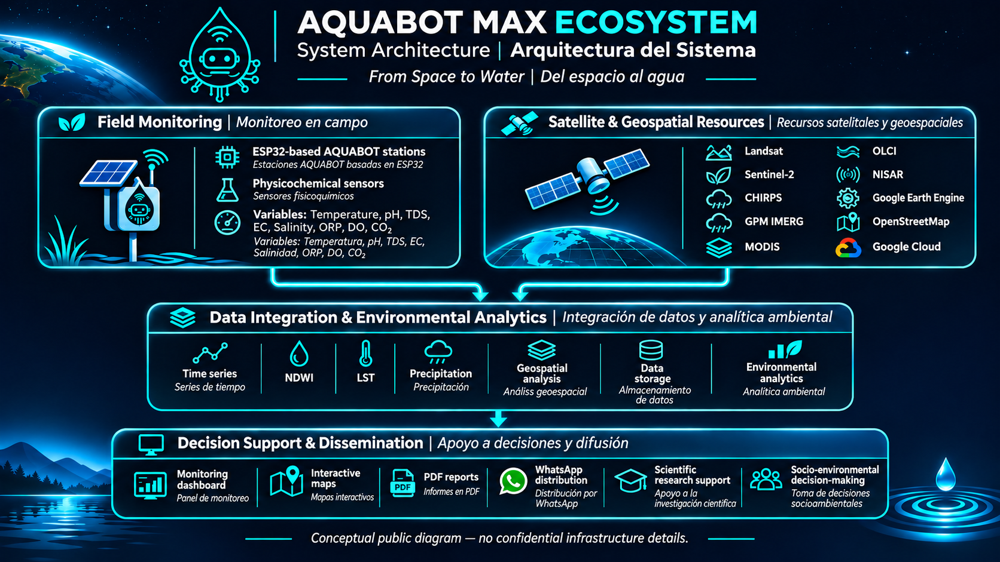

# AQUABOT MAX ECOSYSTEM
## System Architecture | Arquitectura del Sistema

**From Space to Water | Del espacio al agua**

**ODEVE — Open Development Ecosystem**

---

## 1. System Overview | Visión general

### English

AQUABOT MAX ECOSYSTEM is an integrated technological platform combining in-situ physicochemical monitoring, IoT connectivity, satellite Earth observations, geospatial analysis, and environmental reporting.

Its architecture supports the collection, processing, visualization, and interpretation of environmental information to assist scientific research and socio-environmental decision-making.

### Español

AQUABOT MAX ECOSYSTEM es una plataforma tecnológica integral que combina monitoreo fisicoquímico in situ, conectividad IoT, observaciones satelitales de la Tierra, análisis geoespacial y generación de informes ambientales.

Su arquitectura permite recopilar, procesar, visualizar e interpretar información ambiental para apoyar la investigación científica y la toma de decisiones socioambientales.

---

## 2. General Architecture | Arquitectura general



```text
flowchart TD
    A["AQUABOT IoT Stations / Estaciones IoT"]
    B["Water Quality Sensors / Sensores fisicoquímicos"]
    C["IoT Data Transmission / Transmisión IoT"]
    D["Data Integration & Storage / Integración y almacenamiento"]
    E["Environmental Analytics / Analítica ambiental"]
    F["Dashboard & Interactive Maps / Panel y mapas"]
    G["Reports & Decision Support / Informes y apoyo a decisiones"]
    H["Satellite Observations / Observaciones satelitales"]
    I["Google Earth Engine / Procesamiento geoespacial"]
    J["OpenStreetMap / Cartografía de referencia"]

    B --> A
    A --> C
    C --> D
    D --> E
    H --> I
    I --> E
    E --> F
    J --> F
    E --> G
    F --> G
```

*Conceptual architecture; individual infrastructure services and integration paths are documented separately after verification.*

*Arquitectura conceptual; los servicios de infraestructura y sus conexiones específicas se documentarán después de verificarlos.*

---

## 3. Field Monitoring | Monitoreo en campo

### English

AQUABOT monitoring stations incorporate ESP32-based electronic systems and physicochemical sensors.

The ecosystem handles variables including:

- Water temperature
- pH
- Total Dissolved Solids (TDS)
- Electrical Conductivity (EC)
- Salinity
- Oxidation-Reduction Potential (ORP)
- Dissolved Oxygen (DO)
- Carbon dioxide (CO₂)

Some indicators may be estimated from sensor measurements rather than measured independently. Measurement methods and calculation procedures must be identified in scientific reports.

### Español

Las estaciones AQUABOT incorporan sistemas electrónicos basados en ESP32 y sensores fisicoquímicos.

El ecosistema trabaja con variables como:

- Temperatura del agua
- pH
- Sólidos Disueltos Totales (TDS)
- Conductividad Eléctrica (EC)
- Salinidad
- Potencial de Oxidación-Reducción (ORP)
- Oxígeno Disuelto (OD)
- Dióxido de carbono (CO₂)

Algunos indicadores pueden estimarse a partir de mediciones de sensores y no medirse de manera independiente. Los informes científicos deben identificar los métodos de medición y cálculo.

---

## 4. Satellite Earth Observation | Observación satelital

| Resource / Recurso | Application / Aplicación |
|---|---|
| Landsat | Surface temperature and water-related analysis / Temperatura superficial y análisis hídrico |
| Sentinel-2 | Spectral observations and water indices / Observaciones espectrales e índices de agua |
| CHIRPS | Historical precipitation / Precipitación histórica |
| GPM IMERG | Satellite precipitation estimates / Estimaciones satelitales de precipitación |
| MODIS | Water and environmental remote sensing products / Productos ambientales y acuáticos |
| OLCI | Ocean and coastal color observations / Observaciones de color del océano y zonas costeras |
| NISAR | Radar observations and research / Observaciones de radar e investigación |

The ecosystem includes workflows for NDWI, land surface temperature (LST), precipitation, and other environmental products.

El ecosistema incluye procesos de análisis de NDWI, temperatura superficial terrestre (LST), precipitación y otros productos ambientales.

Satellite-derived products are not treated as direct replacements for in-situ physicochemical measurements.

Los productos derivados de satélites no se consideran sustitutos directos de las mediciones fisicoquímicas in situ.

---

## 5. Geospatial & Digital Platforms
### Plataformas geoespaciales y digitales

### Google Earth Engine

Satellite imagery analysis, geospatial processing and environmental time-series workflows.

Análisis de imágenes satelitales, procesamiento geoespacial y series temporales ambientales.

### OpenStreetMap

Geographic reference and interactive map visualization for observation areas and monitoring locations.

Cartografía de referencia y visualización interactiva de zonas de observación y ubicaciones de monitoreo.

### Google Cloud

Google Cloud is identified as a technology used in the broader ecosystem. Specific services and their operational roles will be detailed after verification.

Google Cloud se identifica como una tecnología utilizada en el ecosistema. Los servicios específicos y sus funciones operativas se detallarán después de su verificación.

### Web Platform | Plataforma web

**https://monitoreo.trespalos.org**

Public-facing monitoring dashboards, environmental indicators, time-series visualizations, and geospatial layers.

Paneles públicos de monitoreo, indicadores ambientales, visualización de series temporales y capas geoespaciales.

---

## 6. Environmental Reporting | Informes ambientales

### English

The ecosystem includes workflows for automated environmental summaries, PDF reports, and distribution through WhatsApp.

Public documentation will use authorized examples with sensitive information removed.

### Español

El ecosistema incluye procesos de generación automatizada de resúmenes ambientales, informes PDF y distribución mediante WhatsApp.

La documentación pública utilizará ejemplos autorizados, eliminando información sensible.

---

## 7. Security & Intellectual Property
### Seguridad y propiedad intelectual

This public repository is documentation-focused. It does not disclose application source code, credentials, confidential infrastructure configurations, unpublished patent claims, or sensitive operational procedures.

Este repositorio público está orientado a la documentación. No divulga código fuente, credenciales, configuraciones confidenciales de infraestructura, reivindicaciones de patente no publicadas ni procedimientos operativos sensibles.

---

© 2026 ODEVE — Open Development Ecosystem
