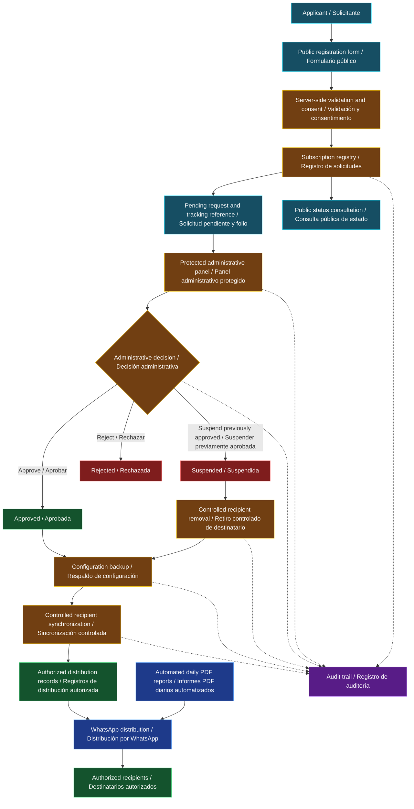

# AQUABOT MAX ECOSYSTEM
## System Architecture | Arquitectura del Sistema

**From Space to Water | Del espacio al agua**

**ODEVE — Open Development Ecosystem**

---

## 1. System Overview | Visión general

### English

AQUABOT MAX ECOSYSTEM is an integrated technological platform combining in-situ physicochemical monitoring, IoT connectivity, satellite Earth observations, geospatial analysis, and environmental reporting.

Its architecture supports the collection, processing, visualization, and interpretation of environmental information to assist scientific research and socio-environmental decision-making.

### Español

AQUABOT MAX ECOSYSTEM es una plataforma tecnológica integral que combina monitoreo fisicoquímico in situ, conectividad IoT, observaciones satelitales de la Tierra, análisis geoespacial y generación de informes ambientales.

Su arquitectura permite recopilar, procesar, visualizar e interpretar información ambiental para apoyar la investigación científica y la toma de decisiones socioambientales.

---

## 2. General Architecture | Arquitectura general


```text
flowchart TD
    A["AQUABOT IoT Stations / Estaciones IoT"]
    B["Water Quality Sensors / Sensores fisicoquímicos"]
    C["IoT Data Transmission / Transmisión IoT"]
    D["Data Integration & Storage / Integración y almacenamiento"]
    E["Environmental Analytics / Analítica ambiental"]
    F["Dashboard & Interactive Maps / Panel y mapas"]
    G["Reports & Decision Support / Informes y apoyo a decisiones"]
    H["Satellite Observations / Observaciones satelitales"]
    I["Google Earth Engine / Procesamiento geoespacial"]
    J["OpenStreetMap / Cartografía de referencia"]

    B --> A
    A --> C
    C --> D
    D --> E
    H --> I
    I --> E
    E --> F
    J --> F
    E --> G
    F --> G
```

*Conceptual architecture; individual infrastructure services and integration paths are documented separately after verification.*

*Arquitectura conceptual; los servicios de infraestructura y sus conexiones específicas se documentarán después de verificarlos.*

---

## 3. Field Monitoring | Monitoreo en campo

### English

AQUABOT monitoring stations incorporate ESP32-based electronic systems and physicochemical sensors.

The ecosystem handles variables including:

- Water temperature
- pH
- Total Dissolved Solids (TDS)
- Electrical Conductivity (EC)
- Salinity
- Oxidation-Reduction Potential (ORP)
- Dissolved Oxygen (DO)
- Carbon dioxide (CO₂)

Some indicators may be estimated from sensor measurements rather than measured independently. Measurement methods and calculation procedures must be identified in scientific reports.

### Español

Las estaciones AQUABOT incorporan sistemas electrónicos basados en ESP32 y sensores fisicoquímicos.

El ecosistema trabaja con variables como:

- Temperatura del agua
- pH
- Sólidos Disueltos Totales (TDS)
- Conductividad Eléctrica (EC)
- Salinidad
- Potencial de Oxidación-Reducción (ORP)
- Oxígeno Disuelto (OD)
- Dióxido de carbono (CO₂)

Algunos indicadores pueden estimarse a partir de mediciones de sensores y no medirse de manera independiente. Los informes científicos deben identificar los métodos de medición y cálculo.

---

## 4. Satellite Earth Observation | Observación satelital

| Resource / Recurso | Application / Aplicación |
|---|---|
| Landsat | Surface temperature and water-related analysis / Temperatura superficial y análisis hídrico |
| Sentinel-2 | Spectral observations and water indices / Observaciones espectrales e índices de agua |
| CHIRPS | Historical precipitation / Precipitación histórica |
| GPM IMERG | Satellite precipitation estimates / Estimaciones satelitales de precipitación |
| MODIS | Water and environmental remote sensing products / Productos ambientales y acuáticos |
| OLCI | Ocean and coastal color observations / Observaciones de color del océano y zonas costeras |
| NISAR | Radar observations and research / Observaciones de radar e investigación |

The ecosystem includes workflows for NDWI, land surface temperature (LST), precipitation, and other environmental products.

El ecosistema incluye procesos de análisis de NDWI, temperatura superficial terrestre (LST), precipitación y otros productos ambientales.

Satellite-derived products are not treated as direct replacements for in-situ physicochemical measurements.

Los productos derivados de satélites no se consideran sustitutos directos de las mediciones fisicoquímicas in situ.

---

## 5. Geospatial & Digital Platforms
### Plataformas geoespaciales y digitales

### Google Earth Engine

Satellite imagery analysis, geospatial processing and environmental time-series workflows.

Análisis de imágenes satelitales, procesamiento geoespacial y series temporales ambientales.

### OpenStreetMap

Geographic reference and interactive map visualization for observation areas and monitoring locations.

Cartografía de referencia y visualización interactiva de zonas de observación y ubicaciones de monitoreo.

### Google Cloud

Google Cloud is identified as a technology used in the broader ecosystem. Specific services and their operational roles will be detailed after verification.

Google Cloud se identifica como una tecnología utilizada en el ecosistema. Los servicios específicos y sus funciones operativas se detallarán después de su verificación.

### Web Platform | Plataforma web

**https://monitoreo.trespalos.org**

Public-facing monitoring dashboards, environmental indicators, time-series visualizations, and geospatial layers.

Paneles públicos de monitoreo, indicadores ambientales, visualización de series temporales y capas geoespaciales.

---

## 6. Environmental Reporting | Informes ambientales

### English

The ecosystem includes workflows for automated environmental summaries, PDF reports, and distribution through WhatsApp.

Public documentation will use authorized examples with sensitive information removed.

### Español

El ecosistema incluye procesos de generación automatizada de resúmenes ambientales, informes PDF y distribución mediante WhatsApp.

La documentación pública utilizará ejemplos autorizados, eliminando información sensible.


### 6.1. Controlled WhatsApp Report Subscriptions | Suscripción autorizada a informes por WhatsApp

**Implementation update / Actualización de implementación:** 2026-11-23

**Status / Estado:** ✅ Operational / Operativo (project-reported verification / verificación reportada por el proyecto).

#### English

The environmental reporting architecture incorporates a controlled subscription workflow that connects public registration, administrative authorization, personal data protection, auditability, and automated daily report distribution through WhatsApp.

Submitting a registration request does not automatically authorize report delivery. Each request must undergo administrative review before the applicant can be incorporated into the authorized distribution system.

#### Español

La arquitectura de informes ambientales incorpora un procedimiento controlado de suscripción que integra el registro público, la autorización administrativa, la protección de datos personales, la trazabilidad y la distribución automatizada de informes diarios mediante WhatsApp.

El envío de una solicitud de registro no autoriza automáticamente la recepción de informes. Cada solicitud debe pasar por una revisión administrativa antes de incorporar al solicitante al sistema de distribución autorizado.

#### 6.1.1. Logical Architecture | Arquitectura lógica



*Conceptual architecture. Internal infrastructure, credentials, personal data, and private configuration details are intentionally excluded.*

*Arquitectura conceptual. Se excluyen deliberadamente los detalles internos de infraestructura, credenciales, datos personales y configuraciones privadas.*

#### 6.1.2. Architectural Components | Componentes arquitectónicos

| Component / Componente | Responsibility / Responsabilidad |
|---|---|
| Public registration / Registro público | Collect subscription requests and explicit privacy consent / Recopilar solicitudes de suscripción y consentimiento explícito de privacidad |
| Server-side validation / Validación del servidor | Validate submitted information and mitigate automated abuse / Validar la información recibida y mitigar abusos automatizados |
| Subscription registry / Registro de solicitudes | Maintain request references, states, consent, and review information / Conservar folios, estados, consentimiento e información de revisión |
| Public status consultation / Consulta pública de estado | Provide request status without exposing personal information / Proporcionar el estado de la solicitud sin exponer información personal |
| Administrative authorization / Autorización administrativa | Review, approve, reject, or suspend eligible requests / Revisar, aprobar, rechazar o suspender solicitudes según corresponda |
| Recipient synchronization / Sincronización de destinatarios | Integrate authorized recipients into the existing daily distribution system / Integrar destinatarios autorizados al sistema existente de distribución diaria |
| Backup and recovery / Respaldo y recuperación | Protect distribution configurations against inconsistent modifications / Proteger las configuraciones de distribución frente a modificaciones inconsistentes |
| Audit trail / Registro de auditoría | Preserve traceability of administrative actions and state changes / Conservar la trazabilidad de las acciones administrativas y cambios de estado |
| Automated reporting / Informes automatizados | Generate daily environmental PDF reports / Generar informes ambientales diarios en PDF |
| WhatsApp distribution / Distribución por WhatsApp | Deliver reports to authorized recipients through the existing automated workflow / Distribuir informes a destinatarios autorizados mediante el proceso automatizado existente |

#### 6.1.3. Security and Data Protection | Seguridad y protección de datos

- Server-side administrative authentication / Autenticación administrativa del lado del servidor.
- Secure credential comparison / Comparación segura de credenciales.
- Server-side input validation and request size restrictions / Validación de entradas y restricciones de tamaño de solicitudes del lado del servidor.
- Rate limiting and honeypot protection / Limitación de frecuencia y protección mediante honeypot.
- Hashed origin identifiers for abuse prevention / Identificadores de origen mediante hash para prevenir abusos.
- Explicit privacy consent / Consentimiento explícito de privacidad.
- Public status consultation without personal data disclosure / Consulta pública de estado sin divulgación de datos personales.
- Administrative action traceability / Trazabilidad de acciones administrativas.
- Administrative credentials excluded from public source code and documentation / Credenciales administrativas excluidas del código público y de la documentación.

#### 6.1.4. Operational Reliability | Confiabilidad operativa

**English**

Recipient synchronization incorporates timestamped backups, temporary writes, safe replacement of distribution records, and coordinated recovery if either distribution record cannot be updated successfully.

Suspension removes only recipients incorporated through the controlled subscription workflow. Existing historical or manually configured recipients are preserved.

Approved and successfully synchronized recipients become eligible for the next scheduled daily distribution.

**Español**

La sincronización de destinatarios incorpora respaldos con marca temporal, escrituras temporales, reemplazo seguro de los registros de distribución y recuperación coordinada cuando alguno de los dos registros no puede actualizarse correctamente.

La suspensión elimina únicamente a los destinatarios incorporados mediante el procedimiento controlado de suscripción. Se preservan los destinatarios históricos o configurados manualmente.

Los destinatarios aprobados y sincronizados correctamente quedan habilitados para la siguiente distribución diaria programada.

#### 6.1.5. Reported Verification | Verificación reportada

| Verification / Verificación | Reported result / Resultado reportado |
|---|---|
| Public registration interface / Interfaz pública de registro | ✅ Operational / Operativa |
| Protected administrative panel / Panel administrativo protegido | ✅ Verified / Verificado |
| Unauthorized administrative access / Acceso administrativo no autorizado | HTTP 401 |
| Incomplete registration request / Solicitud de registro incompleta | HTTP 400 |
| Nonexistent tracking reference / Folio inexistente | HTTP 404 |
| Authenticated administrative API / API administrativa autenticada | ✅ Correct response / Respuesta correcta |
| Automated tests / Pruebas automatizadas | ✅ 5/5 passed / Aprobadas |
| Existing recipients preserved / Destinatarios existentes preservados | ✅ 10/10 |
| Daily distribution configuration / Configuración de distribución diaria | ✅ Enabled and validated / Habilitada y validada |

**Verification scope / Alcance de la verificación:**

These results were reported by the project. No fictitious production subscriptions were created. Independent reproduction and complete end-to-end production delivery verification for a newly approved subscriber are not established by this documentation.

Estos resultados fueron reportados por el proyecto. No se crearon suscripciones ficticias en producción. Esta documentación no acredita una reproducción independiente ni una verificación integral de entrega en producción a un nuevo suscriptor aprobado.

#### 6.1.6. Related Documentation | Documentación relacionada

- [Reports Module / Módulo Reportes](docs/platform-modules/reports/README.md)
- [November 23, 2026 Update / Actualización del 23 de noviembre de 2026](updates/2026/2026-11-23-whatsapp-report-subscriptions.md)
- [Changelog / Historial de cambios](CHANGELOG.md#2026-11-23-whatsapp-report-subscriptions)
- [What's New / Novedades](updates/README.md)
---

## 7. Security & Intellectual Property
### Seguridad y propiedad intelectual

This public repository is documentation-focused. It does not disclose application source code, credentials, confidential infrastructure configurations, unpublished patent claims, or sensitive operational procedures.

Este repositorio público está orientado a la documentación. No divulga código fuente, credenciales, configuraciones confidenciales de infraestructura, reivindicaciones de patente no publicadas ni procedimientos operativos sensibles.

---

© 2026 ODEVE — Open Development Ecosystem
