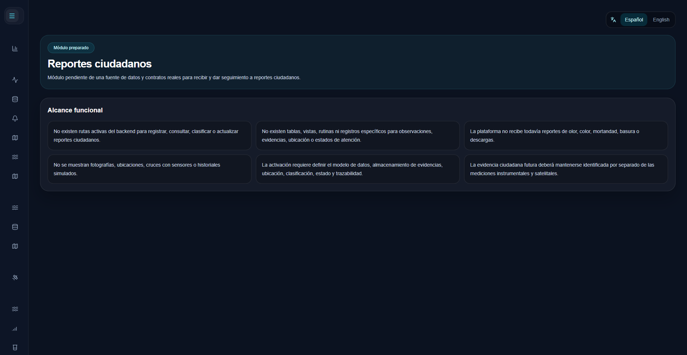

# AQUABOT MAX ECOSYSTEM

## Citizen Environmental Reports | Reportes ambientales ciudadanos

**Project | Proyecto:** AQUABOT MAX ECOSYSTEM  
**Organization | Organización:** ODEVE — Open Development Ecosystem  
**Platform | Plataforma:** https://monitoreo.trespalos.org  
**Module | Módulo:** Citizen Reports | Reportes ciudadanos  
**Development status | Estado de desarrollo:** Under Development | En desarrollo  
**Languages | Idiomas:** English and Spanish | Inglés y español  
**Reference interface | Interfaz de referencia:** November 19, 2026 | 19 de noviembre de 2026

---

## 1. Overview | Descripción general

### English

The Citizen Reports module is a planned component of AQUABOT MAX ECOSYSTEM intended to support the future collection, consultation, classification, and follow-up of community environmental observations.

The prepared interface identifies potential reports concerning water odor, water color, aquatic organism mortality, waste accumulation, and possible discharges.

At the time of documentation, the module does not have active backend routes or operational data structures for receiving citizen reports.

The interface does not display simulated reports, photographs, geographic locations, or historical records.

### Español

El módulo Reportes ciudadanos es un componente previsto de AQUABOT MAX ECOSYSTEM destinado a apoyar la futura recepción, consulta, clasificación y seguimiento de observaciones ambientales comunitarias.

La interfaz preparada identifica posibles reportes relacionados con olor del agua, coloración, mortandad de organismos acuáticos, acumulación de basura y posibles descargas.

Al momento de esta documentación, el módulo no cuenta con rutas activas del backend ni estructuras de datos operativas para recibir reportes ciudadanos.

La interfaz no presenta reportes, fotografías, ubicaciones geográficas ni registros históricos simulados.

---

## 2. Current Development Status | Estado actual de desarrollo

| Component | Status | Estado |
|---|---|---|
| Citizen Reports interface | Prepared | Preparada |
| Report submission | Not implemented | No implementado |
| Report consultation | Not implemented | No implementado |
| Report classification | Not implemented | No implementado |
| Report status updates | Not implemented | No implementado |
| Community observation records | Not available | No disponibles |
| Photographic evidence | Not integrated | No integrada |
| Geographic locations | Not integrated | No integradas |
| Sensor-data cross-references | Not implemented | No implementadas |
| Historical report records | Not available | No disponibles |
| Backend data contracts | Pending definition | Pendientes de definición |
| Database structures | Not available according to the interface | No disponibles según la interfaz |

### English

These statements describe the implementation status reported by the module interface.

They do not imply that environmental observations or community activities have never taken place outside the digital platform.

### Español

Estas afirmaciones describen el estado de implementación reportado por la interfaz del módulo.

No implican que nunca hayan ocurrido observaciones ambientales o actividades comunitarias fuera de la plataforma digital.

---

## 3. Intended Functional Scope | Alcance funcional previsto

### English

The future module is intended to support a structured process for managing citizen environmental reports.

Potential functions include:

- Receiving authorized reports.
- Recording the observed environmental condition.
- Associating geographic references.
- Attaching supporting evidence.
- Classifying the report.
- Recording its attention or review status.
- Consulting historical reports.
- Maintaining traceability of relevant changes.

These capabilities remain development requirements rather than operational functions.

### Español

El futuro módulo está destinado a apoyar un proceso estructurado de gestión de reportes ambientales ciudadanos.

Entre sus posibles funciones se encuentran:

- Recibir reportes autorizados.
- Registrar la condición ambiental observada.
- Asociar referencias geográficas.
- Adjuntar evidencias de respaldo.
- Clasificar el reporte.
- Registrar su estado de atención o revisión.
- Consultar reportes históricos.
- Mantener trazabilidad de cambios relevantes.

Estas capacidades continúan siendo requisitos de desarrollo y no funciones operativas.

---

## 4. Environmental Observation Categories | Categorías de observaciones ambientales

| Category | Description | Descripción |
|---|---|---|
| Water odor | Community observations of unusual or noticeable water odors. | Observaciones comunitarias de olores inusuales o perceptibles en el agua. |
| Water color | Reports of visible changes in water coloration. | Reportes de cambios visibles en la coloración del agua. |
| Aquatic organism mortality | Reports of observed fish or other aquatic organism mortality. | Reportes de mortandad observada de peces u otros organismos acuáticos. |
| Waste accumulation | Reports of visible solid waste accumulation. | Reportes de acumulación visible de residuos sólidos. |
| Possible discharges | Reports of observed or suspected discharges into water bodies. | Reportes de descargas observadas o presuntas hacia cuerpos de agua. |

### English

These categories are explicitly mentioned by the current interface.

Their inclusion describes possible future reporting subjects and does not indicate that any corresponding citizen report has been registered in the platform.

### Español

Estas categorías aparecen mencionadas expresamente en la interfaz actual.

Su inclusión describe posibles temas de reporte futuro y no indica que exista algún reporte ciudadano correspondiente registrado en la plataforma.

---

## 5. Citizen Report Registration | Registro de reportes ciudadanos

### English

A future registration process would require defining a suitable data model and backend service.

Potential report fields could include:

- Unique report identifier.
- Observation category.
- Description of the observed condition.
- Observation date and time.
- Geographic reference.
- Supporting evidence.
- Submission timestamp.
- Review or attention status.
- Relevant traceability information.

These fields are proposed design elements and are not currently available as an operational report form.

### Español

Un futuro proceso de registro requerirá definir un modelo de datos y servicio del backend adecuados.

Los posibles campos de un reporte podrían incluir:

- Identificador único del reporte.
- Categoría de observación.
- Descripción de la condición observada.
- Fecha y hora de observación.
- Referencia geográfica.
- Evidencia de respaldo.
- Fecha y hora de envío.
- Estado de revisión o atención.
- Información relevante de trazabilidad.

Estos campos son elementos de diseño propuestos y no están actualmente disponibles como formulario operativo de reportes.

---

## 6. Photographic and Documentary Evidence | Evidencia fotográfica y documental

### English

Future citizen reports may include photographs, videos, or other supporting documentation.

Any eventual evidence-handling system should establish suitable requirements for:

- Authorized submission.
- File type and size.
- Content review.
- Evidence provenance.
- Storage and access controls.
- Protection of personal information.
- Preservation of relevant metadata.

The current interface does not accept or display actual photographic evidence through this module.

### Español

Los futuros reportes ciudadanos podrán incluir fotografías, videos u otra documentación de respaldo.

Un eventual sistema de gestión de evidencias deberá establecer requisitos adecuados para:

- Envío autorizado.
- Tipo y tamaño de archivos.
- Revisión de contenido.
- Procedencia de la evidencia.
- Almacenamiento y controles de acceso.
- Protección de información personal.
- Conservación de metadatos relevantes.

La interfaz actual no recibe ni presenta evidencias fotográficas reales mediante este módulo.

---

## 7. Geographic References | Referencias geográficas

### English

Geographic information may provide important context for future environmental reports.

Potential location information could include lagoon identification, approximate observation area, and authorized geographic coordinates when appropriate.

The system should avoid publicly exposing sensitive personal locations without a suitable legal and operational basis.

The current screenshot does not demonstrate an active citizen-report map or geographic evidence registry.

### Español

La información geográfica puede proporcionar contexto importante para futuros reportes ambientales.

La información potencial de ubicación podría incluir identificación de laguna, zona aproximada de observación y coordenadas geográficas autorizadas cuando corresponda.

El sistema deberá evitar exponer públicamente ubicaciones personales sensibles sin una base legal y operativa adecuada.

La captura actual no demuestra un mapa activo de reportes ciudadanos ni un registro geográfico de evidencias.

---

## 8. Report Classification | Clasificación de reportes

### English

The prepared interface identifies report classification as a future backend capability.

A future classification system should distinguish the reported subject from its verification status and any subsequent interpretation.

For example, a report concerning suspected discharges should not automatically be classified as a confirmed discharge event.

Classification criteria and review procedures must be defined before implementation.

### Español

La interfaz preparada identifica la clasificación de reportes como una capacidad futura del backend.

Un futuro sistema de clasificación deberá distinguir el tema reportado de su estado de verificación y de cualquier interpretación posterior.

Por ejemplo, un reporte sobre posibles descargas no deberá clasificarse automáticamente como un evento de descarga confirmado.

Los criterios de clasificación y procedimientos de revisión deberán definirse antes de la implementación.

---

## 9. Report Status and Follow-Up | Estado y seguimiento de reportes

### English

Future report management may require documenting the review and attention status of each submission.

Possible workflow stages could include:

1. Received.
2. Under review.
3. Additional information requested.
4. Verified or not verified.
5. Closed or referred to the appropriate organization.

These are conceptual workflow examples and are not currently implemented status categories.

### Español

La futura gestión de reportes podrá requerir documentar el estado de revisión y atención de cada envío.

Entre las posibles etapas de un flujo de trabajo se encuentran:

1. Recibido.
2. En revisión.
3. Información adicional solicitada.
4. Verificado o no verificado.
5. Cerrado o canalizado a la organización correspondiente.

Estos son ejemplos conceptuales de flujo de trabajo y no constituyen categorías de estado actualmente implementadas.

---

## 10. Environmental Evidence Traceability | Trazabilidad de la evidencia ambiental

### English

Traceability is necessary for responsibly using future citizen evidence.

A suitable traceability framework may record:

- Original submission information.
- Date and time of the observed event.
- Source and evidence type.
- Geographic context.
- Relevant changes to the report.
- Review decisions.
- Associated documentation.

A reviewed citizen report must remain identifiable as community evidence rather than an instrument-derived measurement.

### Español

La trazabilidad es necesaria para utilizar responsablemente la futura evidencia ciudadana.

Un esquema adecuado de trazabilidad podrá registrar:

- Información del envío original.
- Fecha y hora del evento observado.
- Fuente y tipo de evidencia.
- Contexto geográfico.
- Cambios relevantes del reporte.
- Decisiones de revisión.
- Documentación asociada.

Un reporte ciudadano revisado deberá seguir identificado como evidencia comunitaria y no como una medición obtenida instrumentalmente.

---

## 11. Relationship with Local Sensors | Relación con sensores locales

### English

Future citizen observations may provide contextual information complementary to AQUABOT local physicochemical measurements.

A report concerning unusual water color or aquatic organism mortality could motivate additional examination of available sensor observations.

However, the temporal or geographic coincidence between a citizen report and a sensor measurement does not independently demonstrate causality.

The current module does not implement active cross-referencing between citizen reports and local sensor records.

### Español

Las futuras observaciones ciudadanas podrán proporcionar información contextual complementaria a las mediciones fisicoquímicas locales de AQUABOT.

Un reporte relacionado con coloración inusual del agua o mortandad de organismos acuáticos podría motivar el examen adicional de observaciones disponibles de los sensores.

Sin embargo, la coincidencia temporal o geográfica entre un reporte ciudadano y una medición instrumental no demuestra de manera independiente causalidad.

El módulo actual no implementa cruces activos entre reportes ciudadanos y registros de sensores locales.

---

## 12. Relationship with Satellite Observations | Relación con observaciones satelitales

### English

Satellite observations may eventually provide additional geographic and temporal context for citizen reports.

Possible future integration could involve examining available remote-sensing products for the reported lagoon and observation period.

Satellite products, community observations, and local instrument measurements represent different types of environmental evidence.

Their interpretation must consider their respective spatial resolution, temporal availability, observational limitations, and validation requirements.

No operational cross-reference between citizen reports and satellite observations is demonstrated in the current module.

### Español

Las observaciones satelitales podrán proporcionar eventualmente contexto geográfico y temporal adicional para los reportes ciudadanos.

Una posible integración futura podría consistir en examinar productos de percepción remota disponibles para la laguna y periodo reportados.

Los productos satelitales, las observaciones comunitarias y las mediciones instrumentales locales representan diferentes tipos de evidencia ambiental.

Su interpretación deberá considerar la resolución espacial, disponibilidad temporal, limitaciones observacionales y requisitos de validación respectivos.

El módulo actual no demuestra cruces operativos entre reportes ciudadanos y observaciones satelitales.

---

## 13. Separation of Evidence Types | Separación de tipos de evidencia

### English

The reference interface explicitly states that future citizen evidence must remain identified separately from instrumental and satellite measurements.

This distinction supports clear scientific interpretation and prevents unsupported equivalence between different observation methods.

A citizen report may document a visible or perceived condition.

A local instrument may measure a physicochemical variable.

A satellite product may provide a remote-sensing environmental indicator.

These sources may complement one another, but none should automatically be treated as interchangeable.

### Español

La interfaz de referencia establece expresamente que la futura evidencia ciudadana deberá mantenerse identificada por separado de las mediciones instrumentales y satelitales.

Esta distinción favorece una interpretación científica clara y evita equivalencias sin respaldo entre diferentes métodos de observación.

Un reporte ciudadano puede documentar una condición visible o percibida.

Un instrumento local puede medir una variable fisicoquímica.

Un producto satelital puede proporcionar un indicador ambiental mediante percepción remota.

Estas fuentes pueden complementarse, pero ninguna debe considerarse automáticamente intercambiable con las otras.

---

## 14. Backend and Database Requirements | Requisitos del backend y base de datos

### English

The current interface states that active backend routes do not exist for registering, consulting, classifying, or updating citizen reports.

It also indicates that the current database does not contain specific tables, views, routines, or records for citizen observations, evidence, locations, or attention status.

Future implementation requires defining:

- An appropriate data model.
- Evidence storage procedures.
- Geographic information handling.
- Classification rules.
- Report status management.
- Traceability requirements.
- Suitable backend data contracts.

These are future development requirements rather than currently available services.

### Español

La interfaz actual señala que no existen rutas activas del backend para registrar, consultar, clasificar o actualizar reportes ciudadanos.

También indica que la base de datos actual no contiene tablas, vistas, rutinas ni registros específicos para observaciones ciudadanas, evidencias, ubicaciones o estados de atención.

La implementación futura requiere definir:

- Un modelo de datos apropiado.
- Procedimientos de almacenamiento de evidencias.
- Manejo de información geográfica.
- Reglas de clasificación.
- Gestión de estados de los reportes.
- Requisitos de trazabilidad.
- Contratos adecuados de datos del backend.

Estos son requisitos de desarrollo futuro y no servicios disponibles actualmente.

---

## 15. Proposed Data Model | Modelo de datos propuesto

The following structure is conceptual and has not been implemented.

La siguiente estructura es conceptual y no se encuentra implementada.

| Entity | Purpose | Propósito |
|---|---|---|
| Citizen reports | Store authorized environmental observations. | Almacenar observaciones ambientales autorizadas. |
| Observation categories | Define supported report subjects. | Definir los temas de reporte admitidos. |
| Geographic references | Associate reports with suitable locations. | Asociar los reportes con ubicaciones apropiadas. |
| Evidence attachments | Associate photographs, videos, or documents. | Asociar fotografías, videos o documentos. |
| Report status history | Document review and attention changes. | Documentar cambios de revisión y atención. |
| Evidence review records | Preserve verification information. | Conservar información de verificación. |
| Access permissions | Control authorized access to reports and evidence. | Controlar el acceso autorizado a reportes y evidencias. |

---

## 16. Personal Data and Privacy | Datos personales y privacidad

### English

Future citizen-reporting services may involve personal information, photographs, and geographic references.

The design should include appropriate privacy safeguards such as:

- Clear information about data collection purposes.
- Appropriate consent or other applicable legal basis.
- Limited collection of necessary personal information.
- Access controls.
- Protection of sensitive locations.
- Secure handling of submitted evidence.
- Appropriate information retention and review procedures.

Particular care is required when reports involve minors or potentially identifiable people in photographs.

These are proposed future requirements, not verified completed privacy mechanisms.

### Español

Los futuros servicios de reportes ciudadanos podrán involucrar información personal, fotografías y referencias geográficas.

El diseño deberá incluir medidas apropiadas de privacidad, como:

- Información clara sobre las finalidades de recopilación de datos.
- Consentimiento adecuado u otra base legal aplicable.
- Recopilación limitada de información personal necesaria.
- Controles de acceso.
- Protección de ubicaciones sensibles.
- Manejo seguro de evidencias enviadas.
- Procedimientos apropiados de conservación y revisión de información.

Se requiere especial cuidado cuando los reportes involucren menores de edad o personas potencialmente identificables en fotografías.

Estos son requisitos futuros propuestos, no mecanismos de privacidad concluidos y verificados.

---

## 17. Avoiding Simulated Reports | Prevención de reportes simulados

### English

The reference interface explicitly states that the module does not display simulated photographs, geographic locations, sensor cross-references, or historical records.

Until operational data sources and backend contracts are implemented, the module remains a prepared informational interface.

This approach prevents hypothetical citizen reports from being mistaken for actual environmental evidence.

### Español

La interfaz de referencia establece expresamente que el módulo no presenta fotografías, ubicaciones geográficas, cruces con sensores ni registros históricos simulados.

Hasta que se implementen fuentes operativas de datos y contratos del backend, el módulo permanece como una interfaz informativa preparada.

Este enfoque evita que los reportes ciudadanos hipotéticos se confundan con evidencia ambiental real.

---

## 18. Development Roadmap | Hoja de ruta de desarrollo

| Stage | Description | Descripción |
|---|---|---|
| 1 | Define citizen-reporting objectives and eligible observation categories. | Definir objetivos de reportes ciudadanos y categorías de observación admitidas. |
| 2 | Establish the report, evidence, location, and status data models. | Establecer los modelos de datos para reportes, evidencias, ubicaciones y estados. |
| 3 | Define backend data contracts and storage requirements. | Definir contratos de datos del backend y requisitos de almacenamiento. |
| 4 | Implement appropriate privacy and access safeguards. | Implementar medidas adecuadas de privacidad y acceso. |
| 5 | Develop authorized report submission procedures. | Desarrollar procedimientos de envío autorizado de reportes. |
| 6 | Implement review, classification, and follow-up workflows. | Implementar flujos de revisión, clasificación y seguimiento. |
| 7 | Integrate authentic report evidence and traceability information. | Integrar evidencias auténticas y datos de trazabilidad de los reportes. |
| 8 | Evaluate responsible contextual integration with local and satellite observations. | Evaluar la integración contextual responsable con observaciones locales y satelitales. |

These stages describe planned development, not completed functionality.

Estas etapas describen desarrollo previsto, no funcionalidades concluidas.

---

## 19. Scientific and Environmental Relevance | Relevancia científica y ambiental

### English

Future citizen reporting may complement AQUABOT MAX ECOSYSTEM environmental monitoring by documenting observations that are not necessarily represented in instrumental measurements.

Examples include visible environmental changes, aquatic organism mortality, waste accumulation, and suspected discharges.

Such observations may help identify situations that warrant further field examination or review of available scientific data.

Citizen evidence must remain distinct from validated instrument measurements, and a report alone does not establish environmental causality.

The current module is a prepared foundation for future citizen-report integration and does not demonstrate an operational reporting service.

### Español

Los futuros reportes ciudadanos podrán complementar el monitoreo ambiental de AQUABOT MAX ECOSYSTEM mediante la documentación de observaciones que no necesariamente están representadas en las mediciones instrumentales.

Entre los ejemplos se encuentran cambios ambientales visibles, mortandad de organismos acuáticos, acumulación de residuos y posibles descargas.

Estas observaciones podrán ayudar a identificar situaciones que requieran examen adicional en campo o revisión de datos científicos disponibles.

La evidencia ciudadana deberá mantenerse diferenciada de las mediciones instrumentales validadas, y un reporte por sí solo no establece causalidad ambiental.

El módulo actual constituye una base preparada para la futura integración de reportes ciudadanos y no demuestra un servicio operativo de recepción de reportes.

---

## 20. User Interface | Interfaz de usuario

| Feature | Description | Descripción |
|---|---|---|
| Module status | Indicates that the Citizen Reports module is prepared. | Indica que el módulo Reportes ciudadanos está preparado. |
| Functional scope | Describes unavailable backend routes and database structures. | Describe rutas del backend y estructuras de base de datos no disponibles. |
| Report categories | Identifies potential environmental reporting subjects. | Identifica posibles temas de reporte ambiental. |
| Evidence requirements | Describes future needs for evidence storage and traceability. | Describe futuras necesidades de almacenamiento de evidencias y trazabilidad. |
| Data-source distinction | States that citizen evidence must remain separate from instrumental and satellite measurements. | Establece que la evidencia ciudadana debe permanecer separada de las mediciones instrumentales y satelitales. |
| Language selector | Interface available in English and Spanish. | Interfaz disponible en inglés y español. |

---

## 21. Functional Development | Desarrollo funcional

**Status | Estado: Under Development | En desarrollo**

### English

The Citizen Reports module is available as a prepared informational interface within AQUABOT MAX ECOSYSTEM.

It currently does not provide active backend routes or operational database structures for receiving, consulting, classifying, or updating citizen reports.

The interface identifies possible future categories including water odor, color, aquatic organism mortality, waste, and possible discharges.

Its activation requires appropriate data models, evidence storage, geographic information handling, classification, attention status, traceability, and backend data contracts.

The module explicitly avoids simulated records and requires future citizen evidence to remain distinguishable from instrumental and satellite measurements.

### Español

El módulo Reportes ciudadanos está disponible como una interfaz informativa preparada dentro de AQUABOT MAX ECOSYSTEM.

Actualmente no proporciona rutas activas del backend ni estructuras operativas de base de datos para recibir, consultar, clasificar o actualizar reportes ciudadanos.

La interfaz identifica posibles categorías futuras, incluyendo olor del agua, coloración, mortandad de organismos acuáticos, basura y posibles descargas.

Su activación requiere modelos de datos adecuados, almacenamiento de evidencias, manejo de información geográfica, clasificación, estados de atención, trazabilidad y contratos de datos del backend.

El módulo evita expresamente registros simulados y requiere que la futura evidencia ciudadana permanezca diferenciada de las mediciones instrumentales y satelitales.

---

---

## 22. Citizen Reports Gallery | Galería de reportes ciudadanos

| Photograph / Fotografía | Description | Descripción |
|---|---|---|
|  | Actual AQUABOT MAX ECOSYSTEM Citizen Reports interface, documented on November 19, 2026. The screenshot shows a prepared informational module for future environmental reporting, including observations of water odor, color changes, aquatic organism mortality, waste accumulation, and possible discharges. The interface states that active backend routes, database structures, and citizen report records are not yet available. Future implementation requires report classification, geographic references, evidence storage, attention status, and traceability. Citizen evidence must remain distinguishable from instrumental and satellite observations. | Captura real del módulo Reportes ciudadanos de AQUABOT MAX ECOSYSTEM, documentada el 19 de noviembre de 2026. La pantalla muestra un módulo informativo preparado para futuros reportes ambientales, incluyendo observaciones de olores en el agua, cambios de coloración, mortandad de organismos acuáticos, acumulación de basura y posibles descargas. La interfaz señala que todavía no existen rutas activas del backend, estructuras de base de datos ni registros de reportes ciudadanos disponibles. Su futura implementación requiere clasificación de reportes, referencias geográficas, almacenamiento de evidencias, estados de atención y trazabilidad. La evidencia ciudadana deberá mantenerse diferenciada de las observaciones instrumentales y satelitales. |

---

**AQUABOT MAX ECOSYSTEM**  
**ODEVE — Open Development Ecosystem**
