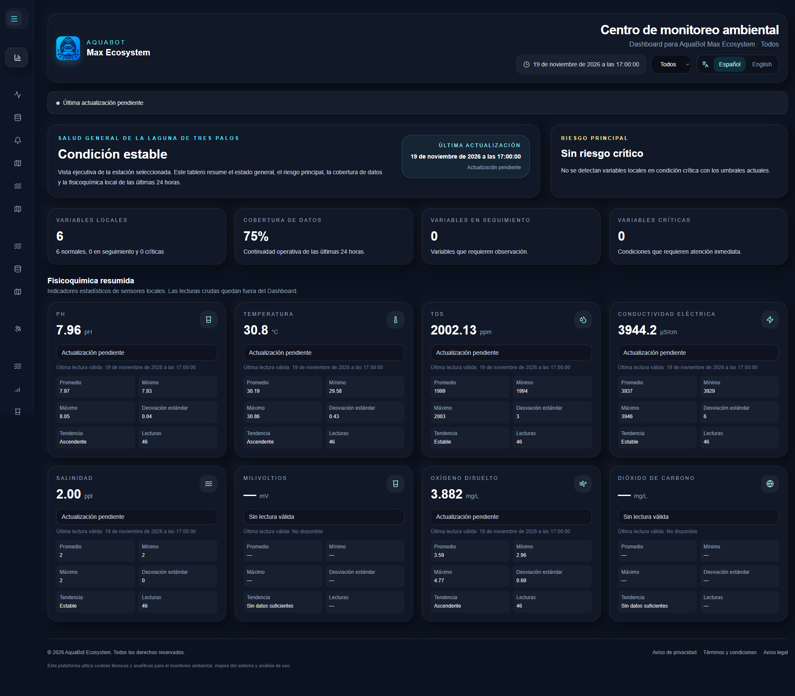

# AQUABOT MAX ECOSYSTEM

## Environmental Monitoring Dashboard | Centro de monitoreo ambiental

**Project | Proyecto:** AQUABOT MAX ECOSYSTEM  
**Organization | Organización:** ODEVE — Open Development Ecosystem  
**Platform | Plataforma:** https://monitoreo.trespalos.org  
**Module | Módulo:** Dashboard  
**Languages | Idiomas:** English and Spanish | Inglés y español

---

## 1. Overview | Descripción general

### English

The AQUABOT MAX ECOSYSTEM Dashboard provides a consolidated view of environmental monitoring information, combining water-quality indicators, data coverage, monitoring status, and descriptive statistics.

The interface helps users review recent physicochemical conditions and identify variables that require additional attention.

The Dashboard supports station selection and bilingual navigation in English and Spanish.

### Español

El Dashboard de AQUABOT MAX ECOSYSTEM presenta una vista integrada de la información de monitoreo ambiental, combinando indicadores de calidad del agua, cobertura de datos, estado del monitoreo y estadísticas descriptivas.

La interfaz permite consultar las condiciones fisicoquímicas recientes e identificar variables que requieren atención adicional.

El Dashboard incorpora selección de estaciones y navegación bilingüe en español e inglés.

---

## 2. Environmental Status | Estado ambiental

| Indicator | English description | Descripción en español |
|---|---|---|
| General condition | Summary of the monitored environmental condition based on available local indicators. | Resumen de la condición ambiental monitoreada a partir de los indicadores locales disponibles. |
| Main risk | Identification of critical conditions according to configured monitoring thresholds. | Identificación de condiciones críticas conforme a los umbrales de monitoreo configurados. |
| Local variables | Number of monitored variables classified as normal, under observation, or critical. | Número de variables monitoreadas clasificadas como normales, en seguimiento o críticas. |
| Data coverage | Continuity of available monitoring information over the last 24 hours. | Continuidad de la información de monitoreo disponible durante las últimas 24 horas. |
| Variables under observation | Number of variables requiring additional monitoring attention. | Número de variables que requieren atención adicional de monitoreo. |
| Critical variables | Number of variables currently classified as critical. | Número de variables clasificadas actualmente como críticas. |

### Dashboard example | Ejemplo del Dashboard

| Indicator | Displayed value | Valor mostrado |
|---|---|---|
| General condition | Stable condition | Condición estable |
| Main risk | No critical risk | Sin riesgo crítico |
| Local variables | 6 | 6 |
| Data coverage | 75% | 75% |
| Variables under observation | 0 | 0 |
| Critical variables | 0 | 0 |

**Reference | Referencia:** Screenshot of November 19, 2026, at 17:00.

These values describe the selected monitoring view at the time shown in the screenshot and are not permanent environmental conditions.

Estos valores corresponden a la vista de monitoreo seleccionada en el momento mostrado en la captura y no representan condiciones ambientales permanentes.

---

## 3. Physicochemical Monitoring | Monitoreo fisicoquímico

The Dashboard displays local physicochemical indicators and their associated statistics.

El Dashboard muestra indicadores fisicoquímicos locales y sus estadísticas asociadas.

| Variable | English description | Descripción en español |
|---|---|---|
| pH | Acidity and alkalinity indicator. | Indicador de acidez y alcalinidad. |
| Temperature | Water-temperature monitoring in degrees Celsius. | Monitoreo de temperatura del agua en grados Celsius. |
| TDS | Total dissolved solids, expressed in ppm. | Sólidos disueltos totales, expresados en ppm. |
| Electrical conductivity | Electrical conductivity of the water, expressed in µS/cm. | Conductividad eléctrica del agua, expresada en µS/cm. |
| Salinity | Estimated dissolved salt concentration. | Concentración estimada de sales disueltas. |
| Millivolts | Electrical potential value displayed when valid data are available. | Valor de potencial eléctrico mostrado cuando existen datos válidos. |
| Dissolved oxygen | Dissolved oxygen information expressed in mg/L. | Información de oxígeno disuelto expresada en mg/L. |
| Carbon dioxide | Carbon dioxide information displayed when valid data are available. | Información de dióxido de carbono mostrada cuando existen datos válidos. |

### Reference readings | Lecturas de referencia

The November 19, 2026 screenshot displays the following values:

La captura del 19 de noviembre de 2026 presenta los siguientes valores:

| Variable | Displayed value | Unit |
|---|---:|---|
| pH | 7.96 | pH |
| Temperature / Temperatura | 30.8 | °C |
| TDS | 2002.13 | ppm |
| Electrical conductivity / Conductividad eléctrica | 3944.2 | µS/cm |
| Salinity / Salinidad | 2.00 | ppt |
| Dissolved oxygen / Oxígeno disuelto | 3.882 | mg/L |
| Millivolts / Milivoltios | No valid reading / Sin lectura válida | mV |
| Carbon dioxide / Dióxido de carbono | No valid reading / Sin lectura válida | mg/L |

These readings are displayed as reference values from the application's monitoring interface.

Estas lecturas se documentan como valores de referencia mostrados en la interfaz de monitoreo de la aplicación.

---

## 4. Descriptive Statistics | Estadísticas descriptivas

| Statistical indicator | English description | Descripción en español |
|---|---|---|
| Average | Mean value of available readings. | Valor promedio de las lecturas disponibles. |
| Minimum | Lowest recorded value in the selected series. | Valor mínimo registrado en la serie seleccionada. |
| Maximum | Highest recorded value in the selected series. | Valor máximo registrado en la serie seleccionada. |
| Standard deviation | Measure of variation among readings. | Medida de variación entre las lecturas. |
| Trend | General direction of change in the available observations. | Dirección general del cambio en las observaciones disponibles. |
| Reading count | Number of readings included in the displayed statistics. | Número de lecturas incluidas en las estadísticas mostradas. |

---

## 5. Data Availability | Disponibilidad de datos

### English

The Dashboard distinguishes between monitoring information that is available and variables without valid readings.

The interface may display messages such as:

- **Update pending:** The interface indicates that a new update is pending.
- **No valid reading:** No valid measurement is available for the variable.
- **Insufficient data:** Available observations do not support the corresponding statistical calculation.

The absence of a valid reading must not be interpreted as a measured value of zero.

The general risk summary refers to available variables and configured thresholds. It does not constitute a complete ecological assessment of the lagoon.

### Español

El Dashboard distingue entre la información de monitoreo disponible y las variables que no cuentan con lecturas válidas.

La interfaz puede presentar mensajes como:

- **Actualización pendiente:** La interfaz indica que está pendiente una nueva actualización.
- **Sin lectura válida:** No se dispone de una medición válida para la variable.
- **Sin datos suficientes:** Las observaciones disponibles no permiten realizar el cálculo estadístico correspondiente.

La ausencia de una lectura válida no debe interpretarse como un valor medido igual a cero.

El resumen general de riesgo corresponde a las variables disponibles y los umbrales configurados. No constituye una evaluación ecológica integral de la laguna.

---

## 6. User Interface | Interfaz de usuario

| Feature | English description | Descripción en español |
|---|---|---|
| Station selector | Selection of the available monitoring view. | Selección de la vista de monitoreo disponible. |
| Language selector | Switching between English and Spanish. | Cambio entre inglés y español. |
| Monitoring timestamp | Date and time associated with the displayed monitoring information. | Fecha y hora asociadas con la información de monitoreo presentada. |
| Navigation menu | Access to other functional modules of AQUABOT MAX ECOSYSTEM. | Acceso a otros módulos funcionales de AQUABOT MAX ECOSYSTEM. |
| Environmental summary | Consolidated presentation of monitoring status and relevant indicators. | Presentación integrada del estado de monitoreo y los indicadores relevantes. |

---

## 7. Scientific and Environmental Relevance | Relevancia científica y ambiental

### English

The Dashboard provides an accessible summary of local physicochemical monitoring information and supports the interpretation of environmental conditions over time.

Its indicators complement the platform's historical records, satellite observations, and environmental reports.

### Español

El Dashboard proporciona un resumen accesible de la información de monitoreo fisicoquímico local y apoya la interpretación temporal de las condiciones ambientales.

Sus indicadores complementan los registros históricos, las observaciones satelitales y los informes ambientales de la plataforma.

---

## 8. Functional Development | Desarrollo funcional

### English

The Dashboard is available in the web application and presents monitoring indicators, descriptive statistics, environmental summaries, and bilingual navigation.

Individual data availability depends on monitoring sources, valid observations, and system updates.

### Español

El Dashboard está disponible en la aplicación web y presenta indicadores de monitoreo, estadísticas descriptivas, resúmenes ambientales y navegación bilingüe.

La disponibilidad de los datos individuales depende de las fuentes de monitoreo, las observaciones válidas y las actualizaciones del sistema.

---

---

## 9. Dashboard Gallery | Galería del Dashboard

| Photograph / Fotografía | Description | Descripción |
|---|---|---|
|  | Actual AQUABOT MAX ECOSYSTEM monitoring dashboard, captured on November 19, 2026. The interface displays the general environmental condition, principal risk indicator, data coverage, physicochemical water-quality variables, descriptive statistics, and monitoring data availability. | Captura real del Dashboard de AQUABOT MAX ECOSYSTEM del 19 de noviembre de 2026. La interfaz presenta la condición ambiental general, el indicador principal de riesgo, la cobertura de datos, las variables fisicoquímicas de calidad del agua, las estadísticas descriptivas y la disponibilidad de información de monitoreo. |

---

**AQUABOT MAX ECOSYSTEM**  
**ODEVE — Open Development Ecosystem**
