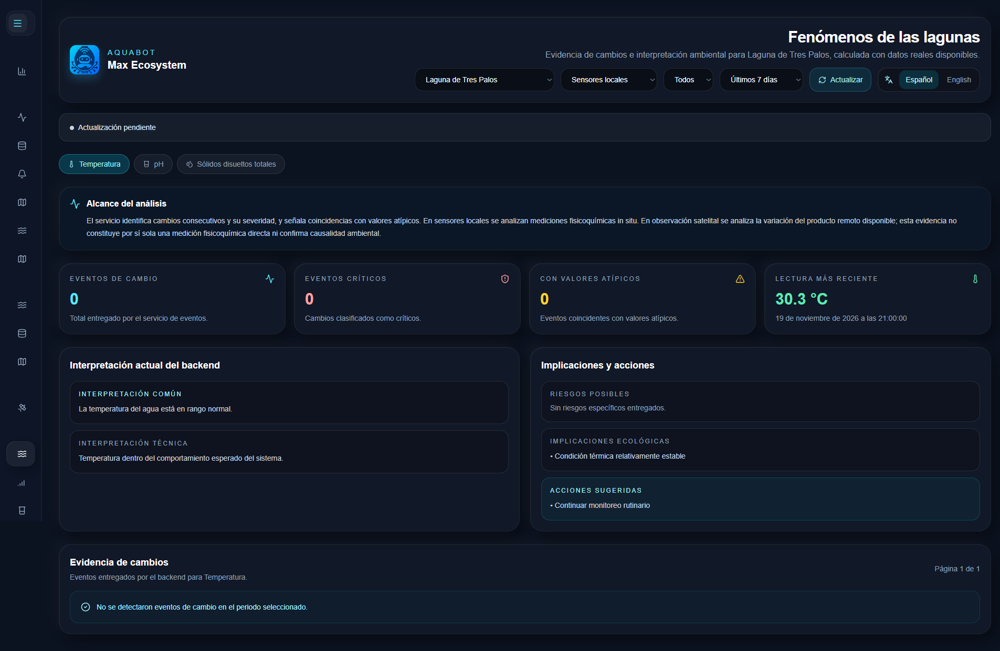

# AQUABOT MAX ECOSYSTEM

## Lagoon Environmental Phenomena | Fenómenos ambientales de las lagunas

**Project | Proyecto:** AQUABOT MAX ECOSYSTEM  
**Organization | Organización:** ODEVE — Open Development Ecosystem  
**Platform | Plataforma:** https://monitoreo.trespalos.org  
**Module | Módulo:** Lagoon Phenomena | Fenómenos de las lagunas  
**Languages | Idiomas:** English and Spanish | Inglés y español  
**Reference interface | Interfaz de referencia:** November 19, 2026 | 19 de noviembre de 2026

---

## 1. Overview | Descripción general

### English

The Lagoon Phenomena module of AQUABOT MAX ECOSYSTEM provides an interface for examining changes in available environmental monitoring observations and their associated interpretations.

According to the interface, the backend service identifies consecutive changes and their severity and reports coincidences with atypical values.

For local sensors, the analysis considers in situ physicochemical measurements. For satellite observations, the analysis concerns variations in available remote-sensing products.

The module provides environmental evidence and interpretation support, but the reported results do not independently establish environmental causality.

### Español

El módulo Fenómenos de las lagunas de AQUABOT MAX ECOSYSTEM proporciona una interfaz para examinar cambios en las observaciones ambientales disponibles y sus interpretaciones asociadas.

De acuerdo con la interfaz, el servicio del backend identifica cambios consecutivos y su severidad, además de señalar coincidencias con valores atípicos.

Para sensores locales, el análisis considera mediciones fisicoquímicas in situ. Para observaciones satelitales, el análisis se refiere a variaciones de los productos de percepción remota disponibles.

El módulo proporciona evidencia ambiental y apoyo para la interpretación, pero los resultados reportados no establecen de manera independiente causalidad ambiental.

---

## 2. Monitoring Selection | Selección del monitoreo

| Component | Description | Descripción |
|---|---|---|
| Lagoon selector | Selection of the lagoon being examined. | Selección de la laguna que se desea examinar. |
| Observation source | Selection of the available environmental information source. | Selección de la fuente de información ambiental disponible. |
| Station or observation filter | Additional filtering according to the selected source. | Filtrado adicional conforme a la fuente seleccionada. |
| Time-range selector | Selection of the observation period. | Selección del periodo de observación. |
| Variable selector | Selection of the environmental indicator to analyze. | Selección del indicador ambiental que se desea analizar. |
| Refresh control | Manual request to update the displayed information. | Control manual para solicitar la actualización de la información presentada. |
| Language selector | Interface available in English and Spanish. | Interfaz disponible en inglés y español. |

### Reference selection | Selección de referencia

**Lagoon | Laguna:** Tres Palos Lagoon | Laguna de Tres Palos  
**Source | Fuente:** Local sensors | Sensores locales  
**Period | Periodo:** Last 7 days | Últimos 7 días  
**Selected variable | Variable seleccionada:** Temperature | Temperatura

---

## 3. Physicochemical Variables | Variables fisicoquímicas

The reference screenshot displays three variable-selection options.

La captura de referencia presenta tres opciones de selección de variables.

| Variable | Description | Descripción |
|---|---|---|
| Temperature | Examination of consecutive changes in available water-temperature observations. | Examen de cambios consecutivos en las observaciones disponibles de temperatura del agua. |
| pH | Examination of consecutive changes in available pH observations. | Examen de cambios consecutivos en las observaciones disponibles de pH. |
| Total dissolved solids | Examination of consecutive changes in available TDS observations. | Examen de cambios consecutivos en las observaciones disponibles de sólidos disueltos totales. |

### English

The availability of results depends on the selected monitoring source, variable, lagoon, and period.

### Español

La disponibilidad de resultados depende de la fuente de monitoreo, variable, laguna y periodo seleccionados.

---

## 4. Analysis Scope | Alcance del análisis

### English

The interface describes a service that identifies consecutive observational changes and their severity.

It also identifies events that coincide with atypical values when such information is available.

The analysis is designed to organize available monitoring evidence and support environmental interpretation.

For local sensors, the input consists of available in situ measurements.

For satellite products, the analysis concerns changes in remote-sensing observations rather than direct physicochemical measurements.

### Español

La interfaz describe un servicio que identifica cambios consecutivos entre observaciones y su severidad.

También identifica eventos coincidentes con valores atípicos cuando dicha información está disponible.

El análisis está diseñado para organizar la evidencia de monitoreo disponible y apoyar la interpretación ambiental.

Para sensores locales, la información de entrada consiste en mediciones in situ disponibles.

Para productos satelitales, el análisis se refiere a cambios en observaciones de percepción remota y no a mediciones fisicoquímicas directas.

---

## 5. Change Events | Eventos de cambio

| Indicator | Description | Descripción |
|---|---|---|
| Change events | Total events returned by the change-event service for the selected query. | Total de eventos entregados por el servicio de cambios para la consulta seleccionada. |
| Critical events | Events classified as critical under the implemented criteria. | Eventos clasificados como críticos conforme a los criterios implementados. |
| Events with atypical values | Events reported as coincident with atypical values. | Eventos reportados como coincidentes con valores atípicos. |
| Latest reading | Most recent displayed observation of the selected variable. | Observación mostrada más reciente de la variable seleccionada. |

### Reference example | Ejemplo de referencia

The screenshot captured on November 19, 2026, displays the following information for the selected temperature view.

La captura del 19 de noviembre de 2026 presenta la siguiente información para la vista de temperatura seleccionada.

| Indicator | Displayed result | Resultado mostrado |
|---|---|---|
| Change events / Eventos de cambio | 0 | 0 |
| Critical events / Eventos críticos | 0 | 0 |
| Events coincident with atypical values / Eventos coincidentes con valores atípicos | 0 | 0 |
| Latest temperature / Temperatura más reciente | 30.3 °C | 30.3 °C |

**Displayed reading timestamp | Fecha y hora de la lectura mostrada:** November 19, 2026, at 21:00 | 19 de noviembre de 2026 a las 21:00

### English

The interface reports no detected change events for the selected period.

These results describe the output of the implemented service for that consultation and do not demonstrate the absence of all environmental phenomena.

### Español

La interfaz reporta que no se detectaron eventos de cambio durante el periodo seleccionado.

Estos resultados describen la respuesta del servicio implementado para esa consulta y no demuestran la ausencia de todos los fenómenos ambientales.

---

## 6. Change Severity | Severidad de los cambios

### English

The module includes a summary of events classified as critical by the backend.

Severity classifications depend on the criteria implemented by the monitoring service.

The reference screenshot does not document the numerical thresholds or classification algorithm used to assign severity levels.

Therefore, the exact classification method must be verified through the corresponding backend technical documentation.

### Español

El módulo incorpora un resumen de los eventos clasificados como críticos por el backend.

Las clasificaciones de severidad dependen de los criterios implementados por el servicio de monitoreo.

La captura de referencia no documenta los umbrales numéricos ni el algoritmo de clasificación utilizado para asignar los niveles de severidad.

Por lo tanto, el método exacto de clasificación debe verificarse mediante la documentación técnica correspondiente del backend.

---

## 7. Coincidences with Atypical Values | Coincidencias con valores atípicos

### English

The interface reports the number of change events coincident with atypical values.

This information can help identify observations requiring additional examination.

A statistical coincidence does not establish that an atypical value caused a particular environmental event.

Further interpretation requires consideration of data quality, observation frequency, environmental context, and the implemented analytical criteria.

### Español

La interfaz reporta el número de eventos de cambio coincidentes con valores atípicos.

Esta información puede ayudar a identificar observaciones que requieren un examen adicional.

Una coincidencia estadística no demuestra que un valor atípico haya causado un evento ambiental determinado.

Su interpretación requiere considerar la calidad de los datos, la frecuencia de observación, el contexto ambiental y los criterios analíticos implementados.

---

## 8. Backend Environmental Interpretation | Interpretación ambiental del backend

### English

The module presents interpretations generated by the backend for the selected variable.

The interface distinguishes between a general interpretation and a technical interpretation.

In the reference screenshot, the temperature view reports:

**General interpretation:** Water temperature is within a normal range according to the system.

**Technical interpretation:** Temperature is within the expected behavior defined by the system.

These messages describe the backend's current interpretation and should not be treated as independent laboratory or ecological conclusions.

### Español

El módulo presenta interpretaciones generadas por el backend para la variable seleccionada.

La interfaz distingue entre una interpretación general y una interpretación técnica.

En la captura de referencia, la vista de temperatura reporta:

**Interpretación común:** La temperatura del agua está en rango normal.

**Interpretación técnica:** Temperatura dentro del comportamiento esperado del sistema.

Estos mensajes describen la interpretación actual del backend y no deben tratarse como conclusiones independientes de laboratorio o evaluaciones ecológicas definitivas.

---

## 9. Environmental Implications and Suggested Actions | Implicaciones ambientales y acciones sugeridas

| Component | Description | Descripción |
|---|---|---|
| Possible risks | Risks reported by the backend for the selected conditions. | Riesgos reportados por el backend para las condiciones seleccionadas. |
| Ecological implications | Contextual interpretation of possible environmental implications. | Interpretación contextual de posibles implicaciones ambientales. |
| Suggested actions | Follow-up actions recommended by the backend. | Acciones de seguimiento recomendadas por el backend. |

### Reference interpretation | Interpretación de referencia

**Possible risks | Riesgos posibles:** No specific risks returned | Sin riesgos específicos entregados.

**Ecological implications | Implicaciones ecológicas:** Relatively stable thermal conditions | Condición térmica relativamente estable.

**Suggested actions | Acciones sugeridas:** Continue routine monitoring | Continuar monitoreo rutinario.

### English

These messages are informative outputs from the implemented interpretation service.

The absence of a reported risk does not establish that all ecological or physicochemical conditions are safe.

### Español

Estos mensajes son resultados informativos del servicio de interpretación implementado.

La ausencia de un riesgo reportado no demuestra que todas las condiciones ecológicas o fisicoquímicas sean seguras.

---

## 10. Change Evidence | Evidencia de cambios

### English

The module includes a section displaying the events returned by the backend for the selected environmental indicator.

The interface supports the consultation of event evidence and displays the corresponding event list when results are available.

In the reference screenshot, no change events were detected during the selected period.

The interface displays:

**"No change events were detected in the selected period."**

### Español

El módulo incorpora una sección que presenta los eventos entregados por el backend para el indicador ambiental seleccionado.

La interfaz permite consultar la evidencia de eventos y presenta el listado correspondiente cuando existen resultados disponibles.

En la captura de referencia, no se detectaron eventos de cambio durante el periodo seleccionado.

La interfaz muestra:

**«No se detectaron eventos de cambio en el periodo seleccionado».**

---

## 11. Local and Satellite Observation Context | Contexto de observaciones locales y satelitales

### English

The interface describes two analytical contexts:

**Local sensors:** Examination of available in situ physicochemical observations.

**Satellite observations:** Examination of changes in available remote-sensing products.

These data sources differ in measured properties, spatial coverage, temporal frequency, and methodological limitations.

Changes in satellite indicators must not be interpreted automatically as equivalent to changes in local physicochemical measurements.

The reference screenshot documents the local-sensor temperature view. It does not independently verify the results of the satellite observation option.

### Español

La interfaz describe dos contextos de análisis:

**Sensores locales:** Examen de observaciones fisicoquímicas in situ disponibles.

**Observaciones satelitales:** Examen de cambios en los productos de percepción remota disponibles.

Estas fuentes difieren en las propiedades observadas, cobertura espacial, frecuencia temporal y limitaciones metodológicas.

Los cambios en indicadores satelitales no deben interpretarse automáticamente como equivalentes a cambios en mediciones fisicoquímicas locales.

La captura de referencia documenta la vista de temperatura de sensores locales. No verifica de manera independiente los resultados de la opción de observación satelital.

---

## 12. Data Availability and Interpretation Limitations | Disponibilidad de datos y limitaciones de interpretación

### English

The analysis depends on the observations available for the selected lagoon, source, variable, and period.

The reference screenshot also displays an update-pending message.

This status should be considered when interpreting the displayed monitoring information.

Important limitations include:

- Absence of events does not establish absence of environmental change.
- Event severity depends on backend classification criteria.
- Statistical coincidence does not establish causality.
- Available interpretations depend on the implemented rules.
- Satellite and local observations represent different types of environmental evidence.
- Results should be evaluated together with data provenance, validity, and observation dates.

### Español

El análisis depende de las observaciones disponibles para la laguna, fuente, variable y periodo seleccionados.

La captura de referencia también muestra un mensaje de actualización pendiente.

Este estado debe considerarse al interpretar la información presentada.

Entre las principales limitaciones se encuentran:

- La ausencia de eventos no demuestra ausencia de cambios ambientales.
- La severidad depende de los criterios de clasificación del backend.
- Una coincidencia estadística no establece causalidad.
- Las interpretaciones disponibles dependen de las reglas implementadas.
- Las observaciones satelitales y locales representan diferentes tipos de evidencia ambiental.
- Los resultados deben evaluarse considerando procedencia, validez y fechas de observación de los datos.

---

## 13. Scientific and Environmental Relevance | Relevancia científica y ambiental

### English

The Lagoon Phenomena module supports environmental monitoring by organizing observational changes, severity classifications, coincidences with atypical values, backend interpretations, and suggested follow-up actions.

These outputs can support the examination of environmental variability and help identify observations that warrant further technical or field review.

The service does not independently establish the causes of environmental phenomena, and its results must be considered alongside other scientific and contextual evidence.

### Español

El módulo Fenómenos de las lagunas apoya el monitoreo ambiental mediante la organización de cambios observacionales, clasificaciones de severidad, coincidencias con valores atípicos, interpretaciones del backend y acciones sugeridas de seguimiento.

Estos resultados pueden contribuir al examen de la variabilidad ambiental y ayudar a identificar observaciones que requieren revisión técnica o verificación adicional en campo.

El servicio no establece de manera independiente las causas de los fenómenos ambientales, y sus resultados deben considerarse junto con otras evidencias científicas y contextuales.

---

## 14. User Interface | Interfaz de usuario

| Feature | Description | Descripción |
|---|---|---|
| Lagoon selector | Selects the lagoon to examine. | Permite seleccionar la laguna que se desea examinar. |
| Source selector | Selects the available environmental observation source. | Permite seleccionar la fuente de observación ambiental disponible. |
| Time-range selector | Defines the period of analysis. | Define el periodo de análisis. |
| Variable selector | Selects the indicator whose changes will be examined. | Selecciona el indicador cuyos cambios serán examinados. |
| Event summary cards | Display event counts and the latest reading. | Presentan los conteos de eventos y la lectura más reciente. |
| Backend interpretation | Displays available general and technical interpretations. | Presenta las interpretaciones generales y técnicas disponibles. |
| Environmental implications | Displays possible risks, ecological implications, and suggested actions. | Presenta riesgos posibles, implicaciones ecológicas y acciones sugeridas. |
| Change evidence | Displays events returned by the backend for the selected query. | Presenta los eventos entregados por el backend para la consulta seleccionada. |
| Refresh control | Requests an update of displayed information. | Solicita una actualización de la información mostrada. |
| Language selector | Interface available in English and Spanish. | Interfaz disponible en inglés y español. |

---

## 15. Functional Development | Desarrollo funcional

### English

The Lagoon Phenomena module is available in the AQUABOT MAX ECOSYSTEM web application.

Its visible features include environmental source selection, physicochemical variable selection, event summaries, backend interpretations, ecological implications, suggested actions, and event-evidence consultation.

The reference screenshot documents a local-sensor temperature consultation with zero change events returned for the selected period.

The classification methodology and the results of other source-variable combinations require separate technical verification.

### Español

El módulo Fenómenos de las lagunas está disponible en la aplicación web AQUABOT MAX ECOSYSTEM.

Sus funciones visibles incluyen selección de fuentes ambientales, selección de variables fisicoquímicas, resúmenes de eventos, interpretaciones del backend, implicaciones ecológicas, acciones sugeridas y consulta de evidencia de eventos.

La captura de referencia documenta una consulta de temperatura de sensores locales con cero eventos de cambio entregados para el periodo seleccionado.

La metodología de clasificación y los resultados de otras combinaciones de fuentes y variables requieren verificación técnica independiente.

---

---

## 16. Lagoon Phenomena Gallery | Galería de fenómenos de las lagunas

| Photograph / Fotografía | Description | Descripción |
|---|---|---|
|  | Actual AQUABOT MAX ECOSYSTEM Lagoon Phenomena interface, captured on November 19, 2026. The screenshot shows the local-sensor temperature view for Tres Palos Lagoon, change-event summaries, critical-event and atypical-value coincidence counts, the most recent temperature reading, backend environmental interpretations, possible ecological implications, suggested monitoring actions, and the change-evidence panel. No change events were reported for the selected period; this does not establish the absence of all environmental processes. | Captura real del módulo Fenómenos de las lagunas de AQUABOT MAX ECOSYSTEM del 19 de noviembre de 2026. La pantalla presenta la consulta de temperatura de sensores locales para la laguna de Tres Palos, resúmenes de eventos de cambio, conteos de eventos críticos y coincidencias con valores atípicos, lectura de temperatura más reciente, interpretaciones ambientales del backend, posibles implicaciones ecológicas, acciones sugeridas de monitoreo y panel de evidencia de cambios. No se reportaron eventos de cambio en el periodo seleccionado; esto no demuestra la ausencia de todos los procesos ambientales. |

---

**AQUABOT MAX ECOSYSTEM**  
**ODEVE — Open Development Ecosystem**
