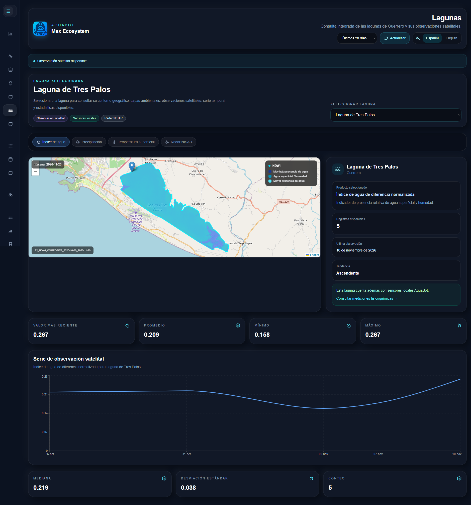

# AQUABOT MAX ECOSYSTEM

## Lagoon Environmental Monitoring | Monitoreo ambiental de lagunas

**Project | Proyecto:** AQUABOT MAX ECOSYSTEM  
**Organization | Organización:** ODEVE — Open Development Ecosystem  
**Platform | Plataforma:** https://monitoreo.trespalos.org  
**Module | Módulo:** Lagoons | Lagunas  
**Languages | Idiomas:** English and Spanish | Inglés y español

---

## 1. Overview | Descripción general

### English

The AQUABOT MAX ECOSYSTEM Lagoons module provides an integrated interface for consulting geographic information, satellite environmental observations, temporal series, and descriptive statistics associated with lagoon ecosystems.

Users can select an available lagoon, explore environmental information layers, examine satellite observations, and consult complementary physicochemical monitoring information where local AQUABOT stations are available.

The module brings together spatial visualization and temporal analysis to support environmental monitoring and scientific interpretation.

### Español

El módulo Lagunas de AQUABOT MAX ECOSYSTEM proporciona una interfaz integrada para consultar información geográfica, observaciones ambientales satelitales, series temporales y estadísticas descriptivas asociadas con ecosistemas lagunares.

El usuario puede seleccionar una laguna disponible, explorar capas de información ambiental, examinar observaciones satelitales y consultar información fisicoquímica complementaria cuando existen estaciones locales AQUABOT.

El módulo integra visualización espacial y análisis temporal para apoyar el monitoreo ambiental y la interpretación científica.

---

## 2. Lagoon Selection | Selección de laguna

| Component | English description | Descripción en español |
|---|---|---|
| Lagoon selector | Selection of the lagoon available for consultation. | Selección de la laguna disponible para consulta. |
| Lagoon identification | Name and geographic context of the selected water body. | Nombre y contexto geográfico del cuerpo de agua seleccionado. |
| Satellite observations | Access to available satellite information for the lagoon. | Acceso a información satelital disponible para la laguna. |
| Local sensors | Access to complementary AQUABOT physicochemical monitoring when available. | Acceso al monitoreo fisicoquímico complementario AQUABOT cuando está disponible. |
| NISAR radar | Access to radar information when observations are available. | Acceso a información radar cuando existen observaciones disponibles. |

### Reference example | Ejemplo de referencia

**Selected lagoon | Laguna seleccionada:** Tres Palos Lagoon | Laguna de Tres Palos  
**Region | Región:** Guerrero, Mexico

The availability of satellite products and local measurements may differ among lagoons.

La disponibilidad de productos satelitales y mediciones locales puede variar entre lagunas.

---

## 3. Environmental Satellite Layers | Capas satelitales ambientales

The visible interface includes the following environmental observation options:

La interfaz visible incorpora las siguientes opciones de observación ambiental:

| Satellite layer | English description | Descripción en español |
|---|---|---|
| NDWI | Normalized Difference Water Index used to examine relative surface-water presence and moisture conditions. | Índice Normalizado de Diferencia de Agua utilizado para examinar la presencia relativa de agua superficial y condiciones de humedad. |
| Precipitation | Satellite-derived rainfall information for the surrounding environment. | Información de precipitación estimada mediante satélites para el entorno. |
| Surface temperature | Satellite-derived surface-temperature observations associated with the selected lagoon. | Observaciones satelitales de temperatura superficial asociadas con la laguna seleccionada. |
| NISAR radar | Radar backscatter observations used for complementary environmental interpretation. | Observaciones de retrodispersión radar utilizadas para la interpretación ambiental complementaria. |

### English

The satellite products have different spatial resolutions, temporal coverage, observation dates, and methodological limitations.

Satellite indicators must not be interpreted as direct measurements of all physicochemical conditions within the water column.

### Español

Los productos satelitales presentan diferentes resoluciones espaciales, coberturas temporales, fechas de observación y limitaciones metodológicas.

Los indicadores satelitales no deben interpretarse como mediciones directas de todas las condiciones fisicoquímicas de la columna de agua.

---

## 4. Geographic Visualization | Visualización geográfica

### English

The module includes a geographic map displaying the selected lagoon and the available satellite layer.

The interface provides visual context for examining spatial environmental observations.

The map includes geographic reference information and an identification of the selected satellite product or scene.

### Español

El módulo incorpora un mapa geográfico que presenta la laguna seleccionada y la capa satelital disponible.

La interfaz proporciona contexto visual para examinar observaciones ambientales espaciales.

El mapa incluye información de referencia geográfica y la identificación del producto o escena satelital seleccionada.

---

## 5. Lagoon Environmental Information | Información ambiental de la laguna

The environmental information panel includes:

La ficha de información ambiental incorpora:

| Component | English description | Descripción en español |
|---|---|---|
| Selected lagoon | Identification of the water body being examined. | Identificación del cuerpo de agua consultado. |
| Selected product | Name and description of the environmental satellite indicator. | Nombre y descripción del indicador ambiental satelital. |
| Available observations | Number of satellite records available for the selected period. | Número de registros satelitales disponibles para el periodo seleccionado. |
| Latest observation | Date of the most recent available satellite observation. | Fecha de la observación satelital disponible más reciente. |
| Trend | General direction of change indicated by the selected temporal series. | Dirección general del cambio indicada por la serie temporal seleccionada. |
| Local monitoring link | Access to complementary physicochemical monitoring information. | Acceso a información complementaria de monitoreo fisicoquímico. |

---

## 6. Reference Satellite Observation | Observación satelital de referencia

### English

The screenshot captured on November 19, 2026, presents NDWI information for Tres Palos Lagoon.

The selected visualization displays five available satellite records, with the latest observation dated November 10, 2026.

### Español

La captura del 19 de noviembre de 2026 presenta información NDWI de la laguna de Tres Palos.

La visualización seleccionada muestra cinco registros satelitales disponibles, cuya observación más reciente corresponde al 10 de noviembre de 2026.

| Indicator | Displayed value | Valor mostrado |
|---|---:|---:|
| Latest NDWI / NDWI más reciente | 0.267 | 0.267 |
| Average / Promedio | 0.209 | 0.209 |
| Minimum / Mínimo | 0.158 | 0.158 |
| Maximum / Máximo | 0.267 | 0.267 |
| Median / Mediana | 0.219 | 0.219 |
| Standard deviation / Desviación estándar | 0.038 | 0.038 |
| Available records / Registros disponibles | 5 | 5 |
| Trend / Tendencia | Ascending | Ascendente |

**Reference date | Fecha de referencia:** November 19, 2026.

### English

NDWI is a dimensionless spectral index. The displayed values represent the satellite-derived indicator used by the platform, not a direct measurement of dissolved oxygen, pH, or other physicochemical variables.

An ascending NDWI trend does not, by itself, establish an improvement in ecological water quality.

### Español

El NDWI es un índice espectral adimensional. Los valores mostrados corresponden al indicador satelital utilizado por la plataforma y no constituyen mediciones directas de oxígeno disuelto, pH u otras variables fisicoquímicas.

Una tendencia ascendente del NDWI no demuestra, por sí sola, una mejora de la calidad ecológica del agua.

---

## 7. Temporal Satellite Observations | Observaciones satelitales temporales

### English

The module includes a temporal chart showing changes in the selected satellite indicator across the available observation dates.

The chart supports the visual examination of environmental variations and complements the geographic map.

The temporal spacing between valid satellite observations may be irregular.

### Español

El módulo incorpora una gráfica temporal que muestra los cambios del indicador satelital seleccionado entre las fechas de observación disponibles.

La gráfica permite examinar visualmente las variaciones ambientales y complementa el mapa geográfico.

Los intervalos temporales entre observaciones satelitales válidas pueden ser irregulares.

---

## 8. Descriptive Statistics | Estadísticas descriptivas

| Statistic | English description | Descripción en español |
|---|---|---|
| Latest value | Most recent available indicator value. | Valor disponible más reciente del indicador. |
| Average | Arithmetic mean of the selected observations. | Media aritmética de las observaciones seleccionadas. |
| Minimum | Lowest value within the selected records. | Valor mínimo entre los registros seleccionados. |
| Maximum | Highest value within the selected records. | Valor máximo entre los registros seleccionados. |
| Median | Central value of the ordered observations. | Valor central de las observaciones ordenadas. |
| Standard deviation | Dispersion of the observations around their average. | Dispersión de las observaciones respecto de su promedio. |
| Record count | Number of records included in the displayed series. | Número de registros incluidos en la serie mostrada. |

---

## 9. Integration with Local AQUABOT Monitoring | Integración con el monitoreo local AQUABOT

### English

The module includes a link to complementary physicochemical monitoring for lagoons with available local AQUABOT sensors.

This relationship allows users to consult satellite-derived environmental information alongside local monitoring indicators.

Satellite observations and local measurements must be compared according to their respective dates, spatial coverage, methods, and limitations.

### Español

El módulo incorpora un enlace al monitoreo fisicoquímico complementario para lagunas que cuentan con sensores locales AQUABOT.

Esta relación permite consultar información ambiental obtenida mediante satélites junto con indicadores locales de monitoreo.

Las observaciones satelitales y las mediciones locales deben compararse considerando sus respectivas fechas, coberturas espaciales, métodos y limitaciones.

---

## 10. User Interface | Interfaz de usuario

| Feature | English description | Descripción en español |
|---|---|---|
| Lagoon selector | Selection of the water body to examine. | Selección del cuerpo de agua que se desea examinar. |
| Satellite layer controls | Selection of available environmental information layers. | Selección de las capas de información ambiental disponibles. |
| Time-range filter | Selection of the period for satellite observation analysis. | Selección del periodo para analizar observaciones satelitales. |
| Geographic map | Spatial visualization of the selected lagoon and satellite product. | Visualización espacial de la laguna y el producto satelital seleccionado. |
| Environmental information panel | Details about the selected indicator and available observations. | Información del indicador seleccionado y las observaciones disponibles. |
| Temporal chart | Visualization of changes in satellite indicators over time. | Visualización de cambios temporales en los indicadores satelitales. |
| Descriptive statistics | Numerical summary of the available observations. | Resumen numérico de las observaciones disponibles. |
| Language selector | Interface available in English and Spanish. | Interfaz disponible en inglés y español. |
| Update control | Manual request to refresh displayed information. | Control manual para solicitar la actualización de la información mostrada. |

---

## 11. Scientific and Environmental Relevance | Relevancia científica y ambiental

### English

The Lagoons module supports an integrated examination of lagoon ecosystems by combining geographic visualization, satellite observations, temporal information, and complementary local monitoring access.

Its information can assist in environmental surveillance, scientific interpretation, and the identification of conditions that warrant additional field verification.

The interpretation of satellite indicators requires attention to observation dates, product characteristics, data quality, and geographic limitations.

### Español

El módulo Lagunas apoya el análisis integrado de los ecosistemas lagunares mediante visualización geográfica, observaciones satelitales, información temporal y acceso al monitoreo local complementario.

Su información puede contribuir a la vigilancia ambiental, la interpretación científica y la identificación de condiciones que requieren verificación adicional en campo.

La interpretación de los indicadores satelitales exige considerar las fechas de observación, características de los productos, calidad de los datos y limitaciones geográficas.

---

## 12. Functional Development | Desarrollo funcional

### English

The Lagoons module is available in the AQUABOT MAX ECOSYSTEM web application.

Its visible functions include lagoon selection, satellite environmental layers, geographic maps, descriptive statistics, temporal observations, and access to complementary local monitoring where available.

The availability of observations depends on the selected lagoon, satellite product, and period.

### Español

El módulo Lagunas está disponible en la aplicación web AQUABOT MAX ECOSYSTEM.

Sus funciones visibles incluyen selección de lagunas, capas ambientales satelitales, mapas geográficos, estadísticas descriptivas, observaciones temporales y acceso al monitoreo local complementario cuando está disponible.

La disponibilidad de observaciones depende de la laguna, el producto satelital y el periodo seleccionados.

---

---

## 13. Lagoons Gallery | Galería de lagunas

| Photograph / Fotografía | Description | Descripción |
|---|---|---|
|  | Actual AQUABOT MAX ECOSYSTEM Lagoons interface, captured on November 19, 2026. The screen displays Tres Palos Lagoon, its geographic map, available satellite layers including NDWI, precipitation, surface temperature and NISAR radar, the selected environmental indicator, descriptive statistics, and a temporal observation chart. The screenshot documents the NDWI visualization for the selected period, not a comprehensive ecological diagnosis of the lagoon. | Captura real del módulo Lagunas de AQUABOT MAX ECOSYSTEM del 19 de noviembre de 2026. La pantalla presenta la laguna de Tres Palos, su mapa geográfico, las capas satelitales disponibles de NDWI, precipitación, temperatura superficial y radar NISAR, el indicador ambiental seleccionado, las estadísticas descriptivas y una gráfica de observaciones temporales. La imagen documenta la visualización NDWI del periodo seleccionado, no un diagnóstico ecológico integral de la laguna. |

---

**AQUABOT MAX ECOSYSTEM**  
**ODEVE — Open Development Ecosystem**
