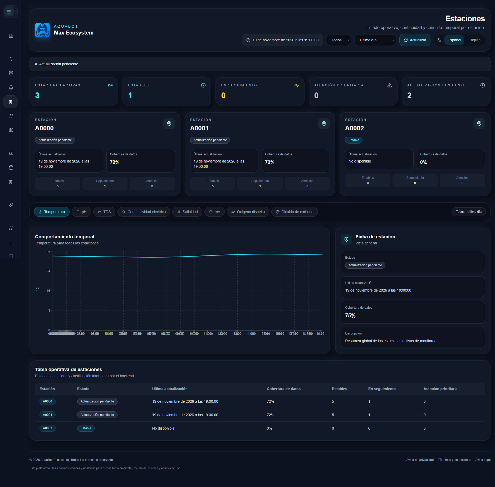

# AQUABOT MAX ECOSYSTEM

## Monitoring Stations | Estaciones de monitoreo

**Project | Proyecto:** AQUABOT MAX ECOSYSTEM  
**Organization | Organización:** ODEVE — Open Development Ecosystem  
**Platform | Plataforma:** https://monitoreo.trespalos.org  
**Module | Módulo:** Monitoring Stations | Estaciones  
**Languages | Idiomas:** English and Spanish | Inglés y español

---

## 1. Overview | Descripción general

### English

The AQUABOT MAX ECOSYSTEM Monitoring Stations module provides an integrated view of station-level information, including operational classifications, data coverage, available observations, temporal visualization, and a consolidated station table.

The module supports the examination of monitoring continuity and the comparison of physicochemical information across registered stations.

Station registration and station data availability are distinct concepts. A station displayed in the interface does not necessarily indicate that it is transmitting valid observations at the time of consultation.

### Español

El módulo Estaciones de AQUABOT MAX ECOSYSTEM presenta una vista integrada de la información por estación, incluyendo clasificaciones operativas, cobertura de datos, observaciones disponibles, visualización temporal y una tabla consolidada de estaciones.

Permite examinar la continuidad del monitoreo y comparar información fisicoquímica entre las estaciones registradas.

El registro de una estación y la disponibilidad de sus datos son conceptos diferentes. Una estación mostrada en la interfaz no necesariamente se encuentra transmitiendo observaciones válidas al momento de la consulta.

---

## 2. Station Monitoring Summary | Resumen del monitoreo de estaciones

| Indicator | English description | Descripción en español |
|---|---|---|
| Active stations | Number of stations included in the application's active-station summary. | Número de estaciones incluidas en el resumen de estaciones activas de la aplicación. |
| Stable | Stations classified as stable according to the backend. | Estaciones clasificadas como estables según el backend. |
| Under observation | Stations requiring additional monitoring attention. | Estaciones que requieren seguimiento adicional. |
| Priority attention | Stations classified as requiring priority attention. | Estaciones clasificadas como de atención prioritaria. |
| Update pending | Stations whose interface indicates a pending update. | Estaciones cuya interfaz indica una actualización pendiente. |

### Reference example | Ejemplo de referencia

The screenshot captured on November 19, 2026, at 19:00 displays the following summary:

La captura del 19 de noviembre de 2026 a las 19:00 presenta:

| Indicator | Displayed count | Cantidad mostrada |
|---|---:|---:|
| Active stations / Estaciones activas | 3 | 3 |
| Stable / Estables | 1 | 1 |
| Under observation / En seguimiento | 0 | 0 |
| Priority attention / Atención prioritaria | 0 | 0 |
| Update pending / Actualización pendiente | 2 | 2 |

These values reflect the application's classification at the time of the screenshot, not an independent verification of equipment connectivity.

Estos valores reflejan la clasificación de la aplicación en el momento de la captura, no una verificación independiente de la conectividad de los equipos.

---

## 3. Registered Monitoring Stations | Estaciones de monitoreo registradas

| Station | Displayed status | Estado mostrado | Data coverage |
|---|---|---|---:|
| A0000 | Update pending | Actualización pendiente | 75% |
| A0001 | Update pending | Actualización pendiente | 75% |
| A0002 | Stable | Estable | 0% |

**Reference date | Fecha de referencia:** November 19, 2026, 19:00.

### English

Stations A0000 and A0001 display 75% data coverage and a last-update timestamp of November 19, 2026, at 19:00.

Station A0002 displays 0% coverage and no available last-update timestamp, despite being classified as stable by the interface.

This classification must not be interpreted as confirmation that A0002 is currently transmitting measurements.

### Español

Las estaciones A0000 y A0001 presentan una cobertura de datos del 75% y una fecha de última actualización del 19 de noviembre de 2026 a las 19:00.

La estación A0002 presenta una cobertura del 0% y no muestra una fecha de última actualización disponible, aunque la interfaz la clasifica como estable.

Esta clasificación no debe interpretarse como confirmación de que A0002 esté transmitiendo mediciones actualmente.

---

## 4. Station Information Cards | Fichas de las estaciones

| Component | English description | Descripción en español |
|---|---|---|
| Station identifier | Unique identifier displayed for the monitoring station. | Identificador único mostrado para la estación de monitoreo. |
| Status | Operational classification displayed by the backend. | Clasificación operativa presentada por el backend. |
| Last update | Date and time of the latest reported update, when available. | Fecha y hora de la última actualización reportada, cuando está disponible. |
| Data coverage | Percentage of monitoring-data coverage for the selected period. | Porcentaje de cobertura de datos durante el periodo seleccionado. |
| Stable variables | Number of monitored variables classified as stable. | Número de variables monitoreadas clasificadas como estables. |
| Variables under observation | Number of variables requiring monitoring attention. | Número de variables que requieren seguimiento. |
| Priority variables | Number of variables classified as requiring priority attention. | Número de variables clasificadas como de atención prioritaria. |

---

## 5. Physicochemical Variable Selection | Selección de variables fisicoquímicas

The module includes controls for consulting the following variables:

El módulo incorpora controles para consultar las siguientes variables:

| Variable | English description | Descripción en español |
|---|---|---|
| Temperature | Water temperature in degrees Celsius. | Temperatura del agua en grados Celsius. |
| pH | Water acidity and alkalinity indicator. | Indicador de acidez y alcalinidad del agua. |
| TDS | Total dissolved solids expressed in ppm. | Sólidos disueltos totales expresados en ppm. |
| Electrical conductivity | Electrical conductivity expressed in µS/cm. | Conductividad eléctrica expresada en µS/cm. |
| Salinity | Salt concentration estimate expressed in ppt. | Estimación de concentración de sales expresada en ppt. |
| Millivolts | Electrical potential information when available. | Información del potencial eléctrico cuando está disponible. |
| Dissolved oxygen | Dissolved oxygen information expressed in mg/L. | Información de oxígeno disuelto expresada en mg/L. |
| Carbon dioxide | Carbon dioxide information when available. | Información de dióxido de carbono cuando está disponible. |

The displayed values depend on the available observations for each station and period.

Los valores mostrados dependen de las observaciones disponibles para cada estación y periodo.

---

## 6. Temporal Monitoring | Monitoreo temporal

### English

The module includes an interactive temporal chart for examining the behavior of the selected physicochemical variable.

The chart can display information associated with the station-selection and time-range controls.

Temporal visualization supports the examination of monitoring continuity and variations in the available observations.

The displayed example presents water temperature over the selected period.

### Español

El módulo incorpora una gráfica temporal interactiva para examinar el comportamiento de la variable fisicoquímica seleccionada.

La gráfica permite mostrar información asociada con los controles de selección de estación y periodo.

La visualización temporal facilita examinar la continuidad del monitoreo y las variaciones de las observaciones disponibles.

El ejemplo mostrado presenta la temperatura del agua durante el periodo seleccionado.

---

## 7. Station Information Panel | Ficha de estación

| Component | English description | Descripción en español |
|---|---|---|
| Station status | Displayed status of the selected monitoring view. | Estado mostrado de la vista de monitoreo seleccionada. |
| Last update | Timestamp associated with the latest available update. | Fecha y hora relacionadas con la última actualización disponible. |
| Data coverage | Percentage of available monitoring data. | Porcentaje de datos de monitoreo disponibles. |
| Description | General information about the selected monitoring context. | Información general sobre el contexto de monitoreo seleccionado. |

---

## 8. Operational Station Table | Tabla operativa de estaciones

### English

The operational station table presents a consolidated comparison of the monitoring stations.

The visible columns include:

- Station identifier.
- Status.
- Last update.
- Data coverage.
- Stable-variable count.
- Variables under observation.
- Variables requiring priority attention.

This information facilitates the review of station-level monitoring conditions and data availability.

### Español

La tabla operativa de estaciones presenta una comparación integrada de los equipos de monitoreo.

Las columnas visibles incluyen:

- Identificador de estación.
- Estado.
- Última actualización.
- Cobertura de datos.
- Número de variables estables.
- Variables en seguimiento.
- Variables de atención prioritaria.

Esta información facilita la revisión de las condiciones de monitoreo y la disponibilidad de datos de cada estación.

---

## 9. Data Availability | Disponibilidad de datos

### English

Station-level information must be interpreted with consideration of the available observations and update timestamps.

The following conditions are distinct:

- **Registered station:** A station included in the application's monitoring catalogue.
- **Data coverage:** The proportion of available observations for the selected period.
- **Update pending:** The interface indicates that an update is pending.
- **Stable classification:** A status assigned by the implemented monitoring rules.
- **No available update:** The interface does not provide a valid last-update timestamp.

A stable classification without recent observations does not establish that the equipment is transmitting normally.

### Español

La información por estación debe interpretarse considerando las observaciones disponibles y las fechas de actualización.

Las siguientes condiciones son diferentes:

- **Estación registrada:** Estación incluida en el catálogo de monitoreo de la aplicación.
- **Cobertura de datos:** Proporción de observaciones disponibles para el periodo seleccionado.
- **Actualización pendiente:** La interfaz indica que existe una actualización pendiente.
- **Clasificación estable:** Estado asignado mediante las reglas de monitoreo implementadas.
- **Sin actualización disponible:** La interfaz no proporciona una fecha válida de última actualización.

Una clasificación estable sin observaciones recientes no demuestra que el equipo esté transmitiendo normalmente.

---

## 10. User Interface | Interfaz de usuario

| Feature | English description | Descripción en español |
|---|---|---|
| Station selector | Selection of a station or consolidated monitoring view. | Selección de una estación o vista consolidada de monitoreo. |
| Time-range filter | Selection of the period for data consultation. | Selección del periodo para la consulta de datos. |
| Update control | Manual request to refresh displayed information. | Control manual para solicitar actualización de la información mostrada. |
| Variable selector | Selection of the physicochemical variable to visualize. | Selección de la variable fisicoquímica que se desea visualizar. |
| Language selector | Interface available in English and Spanish. | Interfaz disponible en inglés y español. |
| Station cards | Summary information for individual stations. | Información resumida de cada estación. |
| Operational table | Consolidated comparison of registered stations. | Comparación integrada de las estaciones registradas. |

---

## 11. Scientific and Operational Relevance | Relevancia científica y operativa

### English

The Monitoring Stations module provides an organized view of station status, data coverage, and available physicochemical observations.

It supports the examination of monitoring continuity, comparisons between stations, and the identification of cases requiring additional technical verification.

Station-status classifications must be evaluated together with observation timestamps and data availability.

### Español

El módulo Estaciones proporciona una vista organizada del estado de las estaciones, la cobertura de datos y las observaciones fisicoquímicas disponibles.

Apoya la revisión de la continuidad del monitoreo, la comparación entre estaciones y la identificación de situaciones que requieren verificación técnica adicional.

Las clasificaciones de estado deben evaluarse conjuntamente con las fechas de observación y la disponibilidad de información.

---

## 12. Functional Development | Desarrollo funcional

### English

The Monitoring Stations module is available in the AQUABOT MAX ECOSYSTEM web application.

Its visible functions include station summaries, station-level classifications, physicochemical variable selection, temporal visualization, station information panels, and an operational table.

The accuracy and completeness of station-status information depend on the available monitoring observations and implemented backend rules.

### Español

El módulo Estaciones está disponible en la aplicación web AQUABOT MAX ECOSYSTEM.

Sus funciones visibles incluyen resúmenes de estaciones, clasificaciones por estación, selección de variables fisicoquímicas, visualización temporal, fichas de estación y una tabla operativa.

La precisión e integridad de los estados dependen de las observaciones de monitoreo disponibles y las reglas implementadas en el backend.

---

---

## 13. Monitoring Stations Gallery | Galería de estaciones de monitoreo

| Photograph / Fotografía | Description | Descripción |
|---|---|---|
|  | Actual AQUABOT MAX ECOSYSTEM Monitoring Stations interface, captured on November 19, 2026. The screen displays the station identifiers A0000, A0001, and A0002, their reported operational status, data coverage, variable classifications, temporal visualization, station information panel, and consolidated operational table. The interface distinguishes registered stations from the availability of valid monitoring observations. | Captura real del módulo Estaciones de AQUABOT MAX ECOSYSTEM del 19 de noviembre de 2026. La pantalla presenta los identificadores A0000, A0001 y A0002, sus estados operativos reportados, cobertura de datos, clasificación de variables, visualización temporal, ficha de estación y tabla operativa consolidada. La interfaz permite distinguir las estaciones registradas de la disponibilidad de observaciones válidas de monitoreo. |

---

**AQUABOT MAX ECOSYSTEM**  
**ODEVE — Open Development Ecosystem**
