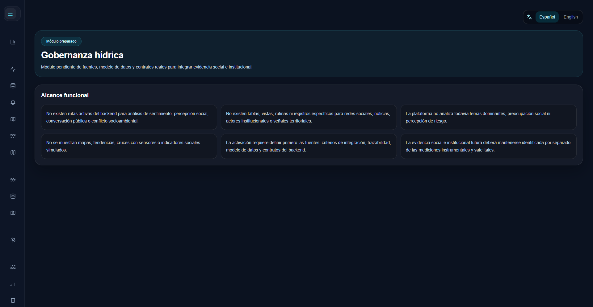

# AQUABOT MAX ECOSYSTEM

## Water Governance and Socioenvironmental Information | Gobernanza hídrica e información socioambiental

**Project | Proyecto:** AQUABOT MAX ECOSYSTEM  
**Organization | Organización:** ODEVE — Open Development Ecosystem  
**Platform | Plataforma:** https://monitoreo.trespalos.org  
**Module | Módulo:** Water Governance | Gobernanza hídrica  
**Development status | Estado de desarrollo:** Under Development | En desarrollo  
**Languages | Idiomas:** English and Spanish | Inglés y español  
**Reference interface | Interfaz de referencia:** November 19, 2026 | 19 de noviembre de 2026

---

## 1. Overview | Descripción general

### English

The Water Governance module is a planned component of AQUABOT MAX ECOSYSTEM intended to support the future integration of social and institutional information related to lagoon ecosystems.

Its prepared interface identifies potential analytical subjects including public perception, sentiment analysis, public conversation, socioenvironmental conflicts, institutional actors, and territorial signals.

At the time of documentation, the module does not have active data sources, backend services, or database structures for these analyses.

The interface does not present simulated social indicators, maps, trends, or environmental data cross-references.

### Español

El módulo Gobernanza hídrica es un componente previsto de AQUABOT MAX ECOSYSTEM destinado a apoyar la futura integración de información social e institucional relacionada con los ecosistemas lagunares.

Su interfaz preparada identifica posibles temas de análisis, incluyendo percepción pública, análisis de sentimiento, conversación pública, conflictos socioambientales, actores institucionales y señales territoriales.

Al momento de esta documentación, el módulo no cuenta con fuentes activas de datos, servicios del backend ni estructuras de base de datos para estos análisis.

La interfaz no presenta indicadores sociales, mapas, tendencias ni cruces con datos ambientales simulados.

---

## 2. Current Development Status | Estado actual de desarrollo

| Component | Status | Estado |
|---|---|---|
| Water Governance interface | Prepared | Preparada |
| Social sentiment analysis | Not implemented | No implementado |
| Public perception analysis | Not implemented | No implementado |
| Public conversation analysis | Not implemented | No implementado |
| Socioenvironmental conflict analysis | Not implemented | No implementado |
| Social media data integration | Not available | No disponible |
| News information integration | Not available | No disponible |
| Institutional actors registry | Not available | No disponible |
| Territorial signals registry | Not available | No disponible |
| Dominant topics analysis | Not implemented | No implementado |
| Social concern indicators | Not implemented | No implementados |
| Social risk perception analysis | Not implemented | No implementado |
| Social and environmental data cross-references | Not implemented | No implementados |
| Backend routes and data contracts | Pending definition | Pendientes de definición |

### English

These development statuses describe the capabilities reported as unavailable by the reference interface.

They do not imply that relevant social or institutional information does not exist outside the platform.

### Español

Estos estados de desarrollo describen las capacidades reportadas como no disponibles por la interfaz de referencia.

No implican que la información social o institucional pertinente no exista fuera de la plataforma.

---

## 3. Intended Functional Scope | Alcance funcional previsto

### English

The future module may provide structured access to social and institutional information relevant to water governance and socioenvironmental decision support.

Potential functions include:

- Identifying relevant institutional information.
- Reviewing public discussions related to lagoon environmental conditions.
- Examining documented public perceptions.
- Organizing socioenvironmental concerns.
- Identifying reported territorial issues.
- Presenting contextual social indicators.
- Supporting the interpretation of social and environmental information.

These functions remain future development objectives rather than operational capabilities.

### Español

El futuro módulo podrá proporcionar acceso estructurado a información social e institucional relevante para la gobernanza hídrica y el apoyo a decisiones socioambientales.

Entre sus posibles funciones se encuentran:

- Identificar información institucional pertinente.
- Revisar conversaciones públicas relacionadas con las condiciones ambientales lagunares.
- Examinar percepciones públicas documentadas.
- Organizar preocupaciones socioambientales.
- Identificar problemáticas territoriales reportadas.
- Presentar indicadores sociales contextuales.
- Apoyar la interpretación de información social y ambiental.

Estas funciones continúan siendo objetivos de desarrollo futuro y no capacidades operativas.

---

## 4. Social Perception | Percepción social

### English

Social perception refers to how individuals or communities understand and evaluate environmental conditions and related concerns.

A future analytical component may examine appropriately sourced information concerning perceptions of lagoon conditions, environmental changes, and water-related concerns.

Any results would require suitable data sources, defined analytical criteria, and explicit acknowledgment of sampling and representation limitations.

The current module does not analyze social perception.

### Español

La percepción social se refiere a la manera en que las personas o comunidades comprenden y valoran las condiciones ambientales y sus preocupaciones relacionadas.

Un futuro componente analítico podrá examinar información obtenida de fuentes apropiadas acerca de percepciones sobre las condiciones de las lagunas, cambios ambientales y preocupaciones relacionadas con el agua.

Cualquier resultado requerirá fuentes de datos adecuadas, criterios analíticos definidos y reconocimiento explícito de las limitaciones de muestreo y representatividad.

El módulo actual no analiza percepción social.

---

## 5. Sentiment Analysis | Análisis de sentimiento

### English

The prepared interface identifies sentiment analysis as a possible future capability.

Such analysis could examine the tone or expressed attitudes found in appropriately obtained public information.

Before implementation, a suitable methodology would need to define:

- Permitted data sources.
- Language and contextual interpretation.
- Analytical categories.
- Validation procedures.
- Representativeness limitations.
- Potential classification errors.

Sentiment analysis results must not automatically be interpreted as the opinion of an entire community.

No operational sentiment-analysis service is demonstrated in the current interface.

### Español

La interfaz preparada identifica el análisis de sentimiento como una posible capacidad futura.

Este análisis podría examinar el tono o las actitudes expresadas en información pública obtenida de manera apropiada.

Antes de implementarlo, una metodología adecuada deberá definir:

- Fuentes de datos permitidas.
- Interpretación lingüística y contextual.
- Categorías analíticas.
- Procedimientos de validación.
- Limitaciones de representatividad.
- Posibles errores de clasificación.

Los resultados de análisis de sentimiento no deberán interpretarse automáticamente como la opinión de una comunidad completa.

La interfaz actual no demuestra un servicio operativo de análisis de sentimiento.

---

## 6. Public Conversation | Conversación pública

### English

Future analysis of public conversation may help organize documented discussions about lagoon conditions, water management, environmental concerns, and institutional responses.

Such analysis should preserve the origin, date, context, and limitations of the information examined.

Public conversation does not necessarily represent the views of all residents or affected groups.

The current module does not provide an active public-conversation analysis service.

### Español

El futuro análisis de conversación pública podrá ayudar a organizar discusiones documentadas sobre las condiciones lagunares, gestión del agua, preocupaciones ambientales y respuestas institucionales.

Este análisis deberá conservar el origen, fecha, contexto y limitaciones de la información examinada.

La conversación pública no representa necesariamente las opiniones de todas las personas habitantes o grupos afectados.

El módulo actual no proporciona un servicio activo de análisis de conversación pública.

---

## 7. Socioenvironmental Conflicts | Conflictos socioambientales

### English

The interface identifies socioenvironmental conflict as a future subject of analysis.

Any future treatment of such information should distinguish documented events, reported concerns, institutional statements, and unverified allegations.

Potential analytical records would require reliable sourcing, contextual review, and appropriate verification.

The platform does not currently demonstrate operational conflict detection or classification.

### Español

La interfaz identifica el conflicto socioambiental como un tema de análisis futuro.

Cualquier tratamiento posterior de esta información deberá distinguir eventos documentados, preocupaciones reportadas, declaraciones institucionales y señalamientos no verificados.

Los posibles registros analíticos requerirán fuentes confiables, revisión contextual y verificación apropiada.

La plataforma no demuestra actualmente detección ni clasificación operativa de conflictos.

---

## 8. Social Media Information | Información de redes sociales

### English

Social media platforms may contain public discussions related to environmental conditions.

Any future integration should consider:

- Applicable platform access rules.
- Authorized data collection.
- Personal-data protection.
- Source provenance.
- Data quality.
- Sampling bias.
- Automated or manipulated content.
- Limitations of interpretation.

The reference interface states that social media data structures and analysis services are not currently available.

### Español

Las plataformas de redes sociales pueden contener conversaciones públicas relacionadas con las condiciones ambientales.

Cualquier integración futura deberá considerar:

- Reglas aplicables de acceso a las plataformas.
- Recopilación autorizada de información.
- Protección de datos personales.
- Procedencia de las fuentes.
- Calidad de los datos.
- Sesgos de muestreo.
- Contenido automatizado o manipulado.
- Limitaciones de interpretación.

La interfaz de referencia señala que las estructuras de datos y los servicios de análisis de redes sociales no están disponibles actualmente.

---

## 9. News and Institutional Information | Noticias e información institucional

### English

Future integration of news and institutional information could provide additional context for environmental monitoring and water governance.

A responsible approach should distinguish:

- Published news reports.
- Official institutional communications.
- Scientific reports.
- Public statements.
- Unverified claims.

Each information source should retain appropriate references, publication dates, and provenance metadata.

No operational news or institutional information integration is demonstrated in the current module.

### Español

La futura integración de noticias e información institucional podría proporcionar contexto adicional para el monitoreo ambiental y la gobernanza hídrica.

Un enfoque responsable deberá distinguir:

- Noticias publicadas.
- Comunicaciones institucionales oficiales.
- Informes científicos.
- Declaraciones públicas.
- Afirmaciones no verificadas.

Cada fuente de información deberá conservar referencias apropiadas, fechas de publicación y metadatos de procedencia.

El módulo actual no demuestra integración operativa de noticias ni información institucional.

---

## 10. Institutional Actors | Actores institucionales

### English

Water governance may involve different public, academic, community, and organizational actors.

A future module could provide structured references to organizations involved in documented water-related activities.

Any registry would require verified organizational information, defined relationships, and appropriate updating procedures.

The current interface does not provide an active institutional-actors registry.

### Español

La gobernanza hídrica puede involucrar diferentes actores públicos, académicos, comunitarios y organizacionales.

Un futuro módulo podría proporcionar referencias estructuradas de organizaciones involucradas en actividades documentadas relacionadas con el agua.

Cualquier registro requerirá información organizacional verificada, relaciones definidas y procedimientos apropiados de actualización.

La interfaz actual no proporciona un registro activo de actores institucionales.

---

## 11. Territorial Signals | Señales territoriales

### English

Territorial signals may refer to geographically associated social or institutional information relevant to lagoon environments.

Future functionality could support the contextual examination of reported conditions by geographic area.

Any spatial analysis must consider the precision, provenance, and authorization status of geographic information.

The current module does not provide operational territorial-signal records or maps.

### Español

Las señales territoriales pueden referirse a información social o institucional asociada geográficamente con los entornos lagunares.

La funcionalidad futura podría apoyar el examen contextual de condiciones reportadas por zona geográfica.

Todo análisis espacial deberá considerar la precisión, procedencia y estado de autorización de la información geográfica.

El módulo actual no proporciona registros ni mapas operativos de señales territoriales.

---

## 12. Dominant Topics and Social Concerns | Temas dominantes y preocupaciones sociales

### English

The prepared interface identifies dominant topics, social concern, and perceived risk as potential future analytical subjects.

Such results would require defined data sources, analytical methods, and validation procedures.

The frequency of a topic in a selected dataset does not necessarily establish its importance to the entire population.

The current module does not generate operational dominant-topic or social-concern indicators.

### Español

La interfaz preparada identifica temas dominantes, preocupación social y percepción de riesgo como posibles temas de análisis futuro.

Estos resultados requerirán fuentes de datos, métodos analíticos y procedimientos de validación definidos.

La frecuencia de un tema en un conjunto seleccionado de datos no establece necesariamente su importancia para toda la población.

El módulo actual no genera indicadores operativos de temas dominantes ni preocupación social.

---

## 13. Social Risk Perception | Percepción social del riesgo

### English

Social risk perception concerns how people understand or evaluate possible threats and environmental consequences.

Future analysis may provide contextual information about perceived water-related concerns.

However, perceived risk and physically measured environmental risk are different concepts.

Social perception should not automatically be treated as a direct measurement of water quality or as proof of an environmental condition.

### Español

La percepción social del riesgo se relaciona con la manera en que las personas comprenden o evalúan posibles amenazas y consecuencias ambientales.

Un futuro análisis podrá proporcionar información contextual acerca de preocupaciones percibidas relacionadas con el agua.

Sin embargo, el riesgo percibido y el riesgo ambiental medido físicamente son conceptos diferentes.

La percepción social no deberá tratarse automáticamente como una medición directa de la calidad del agua ni como prueba de una condición ambiental.

---

## 14. Relationship with Instrumental Monitoring | Relación con el monitoreo instrumental

### English

AQUABOT MAX ECOSYSTEM includes instrumental monitoring of physicochemical variables.

Future water governance information may help contextualize environmental concerns and institutional responses.

However, social indicators and physicochemical measurements have different data origins and validation requirements.

A temporal or geographic coincidence between them does not independently demonstrate causality.

The current governance module does not implement operational cross-references with instrumental monitoring data.

### Español

AQUABOT MAX ECOSYSTEM incorpora monitoreo instrumental de variables fisicoquímicas.

La futura información de gobernanza hídrica podrá ayudar a contextualizar preocupaciones ambientales y respuestas institucionales.

Sin embargo, los indicadores sociales y las mediciones fisicoquímicas tienen orígenes de datos y requisitos de validación diferentes.

Una coincidencia temporal o geográfica entre ellos no demuestra de manera independiente causalidad.

El módulo actual de gobernanza no implementa cruces operativos con datos de monitoreo instrumental.

---

## 15. Relationship with Satellite Observations | Relación con observaciones satelitales

### English

Satellite environmental observations may eventually provide geographic context for documented social or institutional information.

Any future integration should respect the different nature and limitations of remote-sensing products and social evidence.

The availability of a satellite observation does not independently confirm the content of a social report or public discussion.

No operational cross-reference with satellite observations is demonstrated in the current module.

### Español

Las observaciones ambientales satelitales podrán proporcionar eventualmente contexto geográfico para información social o institucional documentada.

Cualquier integración futura deberá respetar la diferente naturaleza y limitaciones de los productos de percepción remota y la evidencia social.

La disponibilidad de una observación satelital no confirma de manera independiente el contenido de un reporte social o conversación pública.

El módulo actual no demuestra cruces operativos con observaciones satelitales.

---

## 16. Separation of Evidence Types | Separación de tipos de evidencia

### English

The reference interface explicitly establishes that future social and institutional evidence must remain separately identified from instrumental and satellite measurements.

This principle supports scientific transparency.

The system should distinguish:

- Social perception information.
- Public conversation records.
- Institutional communications.
- Community evidence.
- Physicochemical measurements.
- Satellite-derived environmental observations.

These sources may complement one another, but they should not be represented as interchangeable or automatically equivalent.

### Español

La interfaz de referencia establece expresamente que la futura evidencia social e institucional deberá mantenerse identificada por separado de las mediciones instrumentales y satelitales.

Este principio favorece la transparencia científica.

El sistema deberá distinguir:

- Información de percepción social.
- Registros de conversación pública.
- Comunicaciones institucionales.
- Evidencia comunitaria.
- Mediciones fisicoquímicas.
- Observaciones ambientales derivadas de satélites.

Estas fuentes pueden complementarse, pero no deberán presentarse como intercambiables ni automáticamente equivalentes.

---

## 17. Backend and Database Requirements | Requisitos del backend y base de datos

### English

The current interface states that no active backend routes exist for sentiment analysis, social perception, public conversation, or socioenvironmental conflict.

It also reports that specific database tables, views, routines, and records are unavailable for social media, news, institutional actors, and territorial signals.

Future activation requires defining:

- Authorized information sources.
- Integration criteria.
- Data provenance and traceability.
- Suitable data models.
- Backend data contracts.
- Analysis and verification methods.

These are development requirements rather than currently operational services.

### Español

La interfaz actual establece que no existen rutas activas del backend para análisis de sentimiento, percepción social, conversación pública o conflicto socioambiental.

También reporta que no se dispone de tablas, vistas, rutinas ni registros específicos para redes sociales, noticias, actores institucionales y señales territoriales.

La activación futura requiere definir:

- Fuentes autorizadas de información.
- Criterios de integración.
- Procedencia y trazabilidad de datos.
- Modelos de datos adecuados.
- Contratos de datos del backend.
- Métodos de análisis y verificación.

Estos son requisitos de desarrollo y no servicios actualmente operativos.

---

## 18. Proposed Data Model | Modelo de datos propuesto

The following structure is conceptual and has not been implemented.

La siguiente estructura es conceptual y no se encuentra implementada.

| Entity | Purpose | Propósito |
|---|---|---|
| Information sources | Identify authorized social and institutional sources. | Identificar fuentes sociales e institucionales autorizadas. |
| Social observations | Store contextual social information when appropriately collected. | Almacenar información social contextual cuando se recopile adecuadamente. |
| Institutional actors | Reference verified organizations and their documented roles. | Referenciar organizaciones verificadas y sus funciones documentadas. |
| Public communications | Preserve references to relevant public statements or documents. | Conservar referencias de declaraciones o documentos públicos pertinentes. |
| Territorial references | Associate information with appropriate geographic context. | Asociar información con contexto geográfico apropiado. |
| Analytical results | Store future processed indicators and methodological metadata. | Almacenar futuros indicadores procesados y metadatos metodológicos. |
| Evidence review records | Document information review and verification status. | Documentar el estado de revisión y verificación de información. |
| Access permissions | Define appropriate rights for accessing and managing information. | Definir derechos apropiados de acceso y gestión de información. |

---

## 19. Data Provenance and Traceability | Procedencia y trazabilidad de datos

### English

Any future integration of social and institutional information should preserve sufficient metadata for responsible interpretation.

Potential metadata include:

- Original information source.
- Publication or observation date.
- Geographic context where appropriate.
- Collection method.
- Information category.
- Review status.
- Analytical methodology.
- Processing version.

These elements are proposed requirements for future development.

### Español

Cualquier futura integración de información social e institucional deberá conservar metadatos suficientes para una interpretación responsable.

Entre los metadatos potenciales se encuentran:

- Fuente original de información.
- Fecha de publicación u observación.
- Contexto geográfico cuando corresponda.
- Método de recopilación.
- Categoría de información.
- Estado de revisión.
- Metodología analítica.
- Versión de procesamiento.

Estos elementos son requisitos propuestos para el desarrollo futuro.

---

## 20. Personal Data, Privacy, and Ethical Considerations | Datos personales, privacidad y consideraciones éticas

### English

Future analysis of social information may involve personal data, opinions, and potentially sensitive contextual information.

Appropriate development should consider:

- Applicable data-protection requirements.
- Authorized information collection.
- Purpose limitation.
- Minimization of collected personal information.
- Access and retention controls.
- Protection against misrepresentation.
- Review of analytical bias.
- Appropriate treatment of identifiable individuals.

Public availability of information does not automatically eliminate privacy or ethical obligations.

These safeguards are proposed development requirements and are not demonstrated as completed operational features in the current module.

### Español

El futuro análisis de información social podrá involucrar datos personales, opiniones e información contextual potencialmente sensible.

Un desarrollo adecuado deberá considerar:

- Requisitos aplicables de protección de datos.
- Recopilación autorizada de información.
- Limitación de finalidades.
- Minimización de información personal recopilada.
- Controles de acceso y conservación.
- Protección frente a interpretaciones incorrectas.
- Revisión de sesgos analíticos.
- Tratamiento apropiado de personas identificables.

La disponibilidad pública de información no elimina automáticamente las obligaciones de privacidad o las consideraciones éticas.

Estas medidas son requisitos propuestos de desarrollo y no funciones operativas concluidas demostradas en el módulo actual.

---

## 21. Avoiding Simulated Social Indicators | Prevención de indicadores sociales simulados

### English

The reference interface explicitly states that the module does not display simulated maps, trends, sensor cross-references, or social indicators.

Until real information sources, data models, and backend services are implemented, the module remains a prepared informational interface.

This approach prevents hypothetical social information from being mistaken for actual evidence.

### Español

La interfaz de referencia establece expresamente que el módulo no presenta mapas, tendencias, cruces con sensores ni indicadores sociales simulados.

Hasta que se implementen fuentes reales de información, modelos de datos y servicios del backend, el módulo permanece como una interfaz informativa preparada.

Este enfoque evita que la información social hipotética se confunda con evidencia real.

---

## 22. Development Roadmap | Hoja de ruta de desarrollo

| Stage | Description | Descripción |
|---|---|---|
| 1 | Define the water governance and socioenvironmental analysis objectives. | Definir los objetivos de gobernanza hídrica y análisis socioambiental. |
| 2 | Identify authorized social and institutional information sources. | Identificar fuentes autorizadas de información social e institucional. |
| 3 | Define appropriate integration criteria and provenance requirements. | Definir criterios de integración y requisitos de procedencia apropiados. |
| 4 | Establish the data models and backend contracts. | Establecer modelos de datos y contratos del backend. |
| 5 | Develop suitable information collection and review procedures. | Desarrollar procedimientos adecuados de recopilación y revisión de información. |
| 6 | Implement validated analytical methods where appropriate. | Implementar métodos analíticos validados cuando corresponda. |
| 7 | Integrate traceable results into the interface. | Integrar resultados trazables en la interfaz. |
| 8 | Evaluate responsible contextual relationships with environmental monitoring information. | Evaluar relaciones contextuales responsables con la información de monitoreo ambiental. |

These stages describe future development, not completed functions.

Estas etapas describen desarrollo futuro, no funciones concluidas.

---

## 23. Scientific and Socioenvironmental Relevance | Relevancia científica y socioambiental

### English

Future water governance information could provide valuable social and institutional context for environmental monitoring and decision support.

Such information may help document public concerns, institutional actions, territorial issues, and the relationship between communities and aquatic ecosystems.

A scientifically responsible approach must recognize the differences between measured environmental conditions, reported social perceptions, and documented institutional information.

The current module is a prepared foundation for future integration and does not demonstrate active social analysis capabilities.

### Español

La futura información de gobernanza hídrica podría proporcionar contexto social e institucional valioso para el monitoreo ambiental y el apoyo a la toma de decisiones.

Esta información podrá ayudar a documentar preocupaciones públicas, acciones institucionales, problemáticas territoriales y la relación entre las comunidades y los ecosistemas acuáticos.

Un enfoque científicamente responsable deberá reconocer las diferencias entre condiciones ambientales medidas, percepciones sociales reportadas e información institucional documentada.

El módulo actual constituye una base preparada para una futura integración y no demuestra capacidades activas de análisis social.

---

## 24. User Interface | Interfaz de usuario

| Feature | Description | Descripción |
|---|---|---|
| Module status | Indicates that the Water Governance module is prepared. | Indica que el módulo Gobernanza hídrica está preparado. |
| Functional scope | Describes the absence of active social-analysis backend routes and corresponding data structures. | Describe la ausencia de rutas activas de análisis social en el backend y de sus estructuras de datos correspondientes. |
| Planned analytical topics | Identifies sentiment, social perception, public conversation, and socioenvironmental conflict as future areas. | Identifica sentimiento, percepción social, conversación pública y conflicto socioambiental como áreas futuras. |
| Integration requirements | Describes the need for real sources, integration criteria, traceability, models, and contracts. | Describe la necesidad de fuentes reales, criterios de integración, trazabilidad, modelos y contratos. |
| Evidence distinction | Establishes separation between social and institutional information and instrumental or satellite observations. | Establece separación entre información social e institucional y observaciones instrumentales o satelitales. |
| Language selector | Interface available in English and Spanish. | Interfaz disponible en inglés y español. |

---

## 25. Functional Development | Desarrollo funcional

**Status | Estado: Under Development | En desarrollo**

### English

The Water Governance module is available as a prepared informational interface within AQUABOT MAX ECOSYSTEM.

The reference interface states that no active backend routes are available for sentiment, public perception, public conversation, or socioenvironmental conflict analysis.

It also reports that the necessary database structures and records for social media, news, institutional actors, and territorial signals are not currently available.

The module does not present operational dominant-topic analysis, social-concern indicators, risk perception, social maps, trends, or cross-references with environmental monitoring data.

Its future activation requires real information sources, defined integration criteria, traceability, suitable data models, and backend contracts.

### Español

El módulo Gobernanza hídrica está disponible como una interfaz informativa preparada dentro de AQUABOT MAX ECOSYSTEM.

La interfaz de referencia establece que no existen rutas activas del backend para análisis de sentimiento, percepción pública, conversación pública o conflictos socioambientales.

También reporta que las estructuras de base de datos y los registros necesarios para redes sociales, noticias, actores institucionales y señales territoriales no están actualmente disponibles.

El módulo no presenta análisis operativos de temas dominantes, indicadores de preocupación social, percepción de riesgo, mapas sociales, tendencias ni cruces con datos de monitoreo ambiental.

Su futura activación requiere fuentes reales de información, criterios de integración definidos, trazabilidad, modelos de datos adecuados y contratos del backend.

---

---

## 26. Water Governance Gallery | Galería de gobernanza hídrica

| Photograph / Fotografía | Description | Descripción |
|---|---|---|
|  | Actual AQUABOT MAX ECOSYSTEM Water Governance interface, documented on November 19, 2026. The screenshot shows a prepared informational module for future integration of social and institutional evidence, including public perception, sentiment analysis, public conversation, socioenvironmental conflicts, institutional actors, news, social media, and territorial signals. The interface reports that active backend routes, suitable database structures, and operational social indicators are not currently available. Its future implementation requires real information sources, integration criteria, traceability, data models, and backend contracts. Social and institutional evidence must remain distinguishable from instrumental and satellite measurements. | Captura real del módulo Gobernanza hídrica de AQUABOT MAX ECOSYSTEM, documentada el 19 de noviembre de 2026. La pantalla presenta un módulo informativo preparado para la futura integración de evidencia social e institucional, incluyendo percepción pública, análisis de sentimiento, conversación pública, conflictos socioambientales, actores institucionales, noticias, redes sociales y señales territoriales. La interfaz señala que todavía no existen rutas activas del backend, estructuras de base de datos adecuadas ni indicadores sociales operativos disponibles. Su implementación futura requiere fuentes reales de información, criterios de integración, trazabilidad, modelos de datos y contratos del backend. La evidencia social e institucional deberá mantenerse diferenciada de las mediciones instrumentales y satelitales. |

---

**AQUABOT MAX ECOSYSTEM**  
**ODEVE — Open Development Ecosystem**
