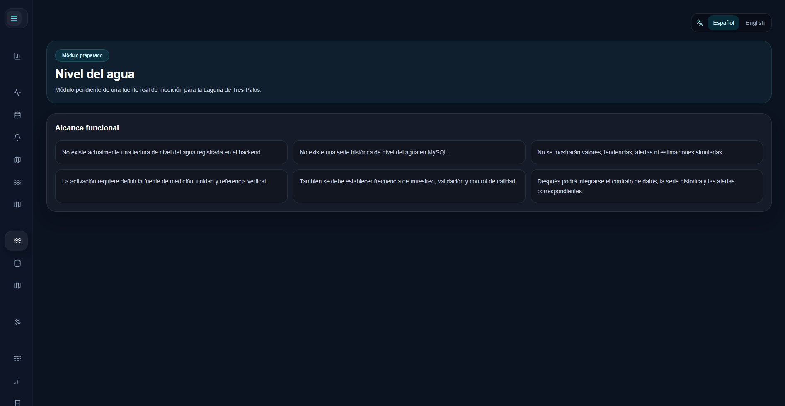

# AQUABOT MAX ECOSYSTEM

## Water Level Monitoring | Monitoreo del nivel del agua

**Project | Proyecto:** AQUABOT MAX ECOSYSTEM  
**Organization | Organización:** ODEVE — Open Development Ecosystem  
**Platform | Plataforma:** https://monitoreo.trespalos.org  
**Module | Módulo:** Water Level | Nivel del agua  
**Development status | Estado de desarrollo:** Under Development | En desarrollo  
**Languages | Idiomas:** English and Spanish | Inglés y español

---

## 1. Overview | Descripción general

### English

The Water Level module is part of the hydrology and morphometry section of AQUABOT MAX ECOSYSTEM.

Its interface has been prepared for the future integration of water-level measurements associated with Tres Palos Lagoon, Guerrero, Mexico.

At the time of documentation, the module does not have a real measurement source connected to the backend.

The interface explicitly communicates this limitation and does not display unsupported water-level values, simulated trends, or unverified alerts.

### Español

El módulo Nivel del agua forma parte de la sección de hidrología y morfometría de AQUABOT MAX ECOSYSTEM.

Su interfaz está preparada para integrar posteriormente mediciones del nivel del agua asociadas con la laguna de Tres Palos, Guerrero, México.

Al momento de esta documentación, el módulo no cuenta con una fuente real de medición conectada al backend.

La interfaz comunica expresamente esta limitación y no presenta valores de nivel del agua sin respaldo, tendencias simuladas ni alertas no verificadas.

---

## 2. Current Implementation Status | Estado actual de implementación

| Component | Status | Estado |
|---|---|---|
| Navigation menu | Available | Disponible |
| Module interface | Prepared | Preparada |
| Real measurement source | Not integrated | No integrada |
| Backend water-level readings | Not available | No disponibles |
| Historical water-level series in MySQL | Not available | No disponible |
| Water-level trends | Not enabled | No habilitadas |
| Water-level alerts | Not enabled | No habilitadas |
| Simulated water-level estimates | Not displayed | No se muestran |

### English

The current implementation provides an informational interface describing the prerequisites for future operation.

The module must not be represented as an operational water-level monitoring system until its measurement source and data-processing workflow have been implemented and verified.

### Español

La implementación actual proporciona una interfaz informativa que describe los requisitos previos para su futura operación.

El módulo no debe presentarse como un sistema operativo de monitoreo del nivel del agua hasta que su fuente de medición y el procesamiento de datos se encuentren implementados y verificados.

---

## 3. Functional Scope | Alcance funcional

### English

The visible interface states that:

1. No water-level reading is currently registered in the backend.
2. No historical water-level series currently exists in MySQL.
3. No water-level values, trends, alerts, or simulated estimates will be displayed.
4. Activation requires defining a real measurement source, measurement unit, and vertical reference.
5. Sampling frequency, validation, and quality-control procedures must be established.
6. The data contract, historical series, and corresponding alerts may be integrated after these prerequisites are met.

### Español

La interfaz visible establece que:

1. Actualmente no existe una lectura de nivel del agua registrada en el backend.
2. No existe una serie histórica de nivel del agua en MySQL.
3. No se mostrarán valores, tendencias, alertas ni estimaciones simuladas del nivel del agua.
4. La activación requiere definir una fuente real de medición, la unidad y la referencia vertical.
5. Deben establecerse la frecuencia de muestreo, la validación y los procedimientos de control de calidad.
6. Después de cumplir estos requisitos podrán integrarse el contrato de datos, la serie histórica y las alertas correspondientes.

---

## 4. Measurement Requirements | Requisitos de medición

The following requirements must be defined before activation.

Los siguientes requisitos deben definirse antes de la activación.

| Requirement | English description | Descripción en español |
|---|---|---|
| Measurement source | Identify and integrate a verifiable water-level measurement source. | Identificar e integrar una fuente verificable de medición del nivel del agua. |
| Measurement unit | Define the units used to express water-level observations. | Definir las unidades utilizadas para expresar las observaciones del nivel del agua. |
| Vertical reference | Establish the reference datum or elevation against which levels will be expressed. | Establecer la referencia vertical o cota respecto de la cual se expresarán los niveles. |
| Sampling frequency | Define how frequently observations will be obtained. | Definir la frecuencia con la que se obtendrán las observaciones. |
| Validation | Establish criteria for determining whether an observation is valid. | Establecer criterios para determinar si una observación es válida. |
| Quality control | Define procedures for reviewing measurement consistency and reliability. | Definir procedimientos para revisar la consistencia y confiabilidad de las mediciones. |

---

## 5. Data Integration Requirements | Requisitos de integración de datos

### English

Once a real measurement source has been defined and validated, the module may be connected to the system's data-processing infrastructure.

The visible development plan identifies three subsequent integration components:

- A defined data contract between the measurement source and the application.
- A historical series of validated water-level observations.
- Alert functionality based on verified information and documented criteria.

These capabilities are planned and must not be presented as currently implemented.

### Español

Una vez definida y validada una fuente real de medición, el módulo podrá conectarse con la infraestructura de procesamiento de datos del sistema.

El plan de desarrollo visible identifica tres componentes posteriores de integración:

- Un contrato de datos definido entre la fuente de medición y la aplicación.
- Una serie histórica de observaciones validadas del nivel del agua.
- Funcionalidad de alertas basada en información verificada y criterios documentados.

Estas capacidades están previstas y no deben presentarse como funcionalidades actualmente implementadas.

---

## 6. Data Integrity and Scientific Transparency | Integridad de datos y transparencia científica

### English

The current interface deliberately avoids displaying water-level values that have not been obtained from a verified measurement source.

This distinction is important because a geographic representation of a lagoon, a satellite observation, or a physicochemical measurement does not automatically provide a valid water-level measurement.

The absence of a measurement must be clearly distinguished from a measured water level of zero.

Any future numerical results must include appropriate measurement units, reference information, observation dates, and validation criteria.

### Español

La interfaz actual evita deliberadamente mostrar valores del nivel del agua que no hayan sido obtenidos mediante una fuente de medición verificada.

Esta distinción es importante porque una representación geográfica de la laguna, una observación satelital o una medición fisicoquímica no proporcionan automáticamente una medición válida del nivel del agua.

La ausencia de una medición debe distinguirse claramente de un nivel del agua medido igual a cero.

Cualquier resultado numérico futuro deberá incluir las unidades de medición correspondientes, información de referencia, fechas de observación y criterios de validación.

---

## 7. Scientific and Environmental Relevance | Relevancia científica y ambiental

### English

Water-level observations can contribute to the hydrological characterization of lagoon ecosystems.

When reliable measurements become available, they may support the study of temporal changes in lagoon conditions and complement other monitoring information.

However, the present module does not provide water-level measurements or hydrological conclusions.

Its current purpose is to communicate the intended functionality and the requirements for its scientific and technical implementation.

### Español

Las observaciones del nivel del agua pueden contribuir a la caracterización hidrológica de los ecosistemas lagunares.

Cuando se disponga de mediciones confiables, podrán apoyar el estudio de los cambios temporales en las condiciones lagunares y complementar otros datos de monitoreo.

Sin embargo, el módulo actual no proporciona mediciones del nivel del agua ni conclusiones hidrológicas.

Su propósito actual es comunicar la funcionalidad prevista y los requisitos para su implementación científica y técnica.

---

## 8. Development Roadmap | Hoja de ruta de desarrollo

| Stage | English description | Descripción en español |
|---|---|---|
| 1 | Define the real water-level measurement source. | Definir la fuente real de medición del nivel del agua. |
| 2 | Establish measurement units and vertical reference. | Establecer unidades de medición y referencia vertical. |
| 3 | Define sampling frequency and quality-control procedures. | Definir frecuencia de muestreo y procedimientos de control de calidad. |
| 4 | Implement and validate the data contract and backend integration. | Implementar y validar el contrato de datos y la integración con el backend. |
| 5 | Develop a historical series using validated observations. | Desarrollar una serie histórica con observaciones validadas. |
| 6 | Integrate temporal visualization and scientifically supported alerts. | Integrar visualización temporal y alertas con respaldo científico. |

These stages represent future work, not completed functionality.

Estas etapas representan trabajo futuro, no funcionalidades concluidas.

---

## 9. User Interface | Interfaz de usuario

| Feature | English description | Descripción en español |
|---|---|---|
| Module status | Indicates that the interface is prepared but awaiting a real measurement source. | Indica que la interfaz está preparada, pero requiere una fuente real de medición. |
| Functional scope | Lists the current limitations and prerequisites for activation. | Enumera las limitaciones actuales y los requisitos para la activación. |
| Language selector | Interface available in English and Spanish. | Interfaz disponible en inglés y español. |

---

## 10. Functional Development | Desarrollo funcional

**Status | Estado: Under Development | En desarrollo**

### English

The Water Level module is present in the AQUABOT MAX ECOSYSTEM navigation system as a prepared informational interface.

It is not currently an operational water-level measurement service.

Its activation is dependent on the integration and validation of a real measurement source and the necessary data-management procedures.

### Español

El módulo Nivel del agua está presente en la navegación de AQUABOT MAX ECOSYSTEM como una interfaz informativa preparada.

Actualmente no constituye un servicio operativo de medición del nivel del agua.

Su activación depende de la integración y validación de una fuente real de medición y de los procedimientos necesarios para gestionar los datos.

---

---

## 11. Water Level Gallery | Galería del nivel del agua

| Photograph / Fotografía | Description | Descripción |
|---|---|---|
|  | Actual AQUABOT MAX ECOSYSTEM Water Level module interface, documented on November 19, 2026. The screenshot shows the prepared module and explains that no real water-level measurement source or historical series is currently integrated. It also identifies the technical prerequisites for future implementation, including measurement units, vertical reference, sampling frequency, validation, and quality control. | Captura real del módulo Nivel del agua de AQUABOT MAX ECOSYSTEM, documentada el 19 de noviembre de 2026. La pantalla muestra el módulo preparado y explica que todavía no se ha integrado una fuente real de medición del nivel del agua ni una serie histórica. También identifica los requisitos técnicos para su futura implementación, como unidades de medición, referencia vertical, frecuencia de muestreo, validación y control de calidad. |

---

**AQUABOT MAX ECOSYSTEM**  
**ODEVE — Open Development Ecosystem**
