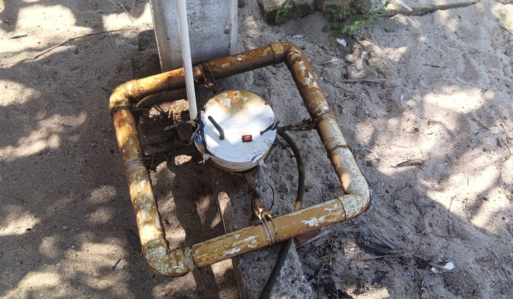
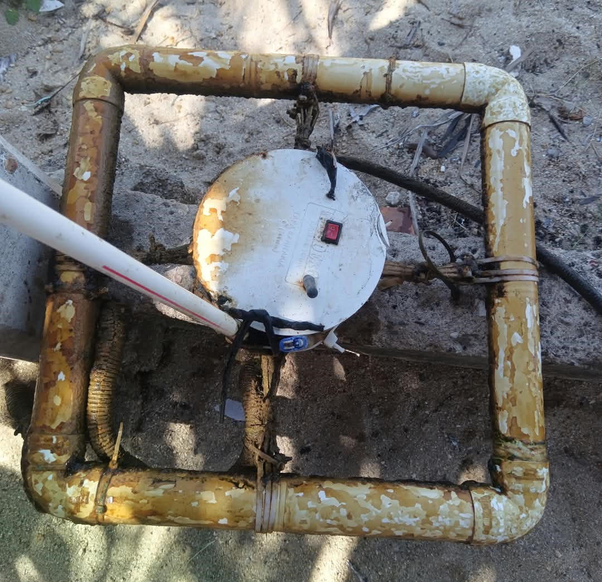

# AQUABOT MAX ECOSYSTEM

## Fixed Monitoring Stations | Estaciones fijas de monitoreo

**Project | Proyecto:** AQUABOT MAX ECOSYSTEM  
**Organization | Organización:** ODEVE — Open Development Ecosystem  
**Category | Categoría:** Environmental Monitoring | Monitoreo ambiental

---

## 1. Overview | Descripción general

### English

Fixed AQUABOT monitoring stations are part of the technological development of AQUABOT MAX ECOSYSTEM.

These stations support the continuous collection and remote transmission of physicochemical water-quality measurements, contributing to environmental monitoring and the generation of information for socio-environmental decision-making.

### Español

Las estaciones fijas AQUABOT forman parte del desarrollo tecnológico de AQUABOT MAX ECOSYSTEM.

Estas estaciones permiten la recopilación continua y transmisión remota de mediciones fisicoquímicas de la calidad del agua, contribuyendo al monitoreo ambiental y a la generación de información para la toma de decisiones socioambientales.

---

## 2. Monitoring Capabilities | Capacidades de monitoreo

| Component | English description | Descripción en español |
|---|---|---|
| Monitoring | Periodic acquisition of physicochemical water-quality measurements | Adquisición periódica de mediciones fisicoquímicas de la calidad del agua |
| Electronics | Microcontroller-based data acquisition and processing | Adquisición y procesamiento de datos mediante microcontroladores |
| Connectivity | Remote transmission of monitoring data | Transmisión remota de datos de monitoreo |
| Energy | Power systems adapted to field operating conditions | Sistemas de alimentación adaptados a las condiciones de operación en campo |
| Installation | Fixed mounting structures for monitoring stations | Estructuras de montaje fijo para estaciones de monitoreo |
| Maintenance | Field inspection, cleaning, and equipment verification | Inspección en campo, limpieza y verificación de los equipos |

---

## 3. Photographic Evidence | Evidencia fotográfica

This section documents the installation, operation, inspection, and maintenance of fixed AQUABOT monitoring stations.

Esta sección documenta la instalación, operación, inspección y mantenimiento de las estaciones fijas AQUABOT.

### Field Documentation Gallery | Galería de documentación de campo

| Photograph / Fotografía | Description | Descripción |
|---|---|---|
|  | General view of an AQUABOT monitoring unit during field inspection, showing the square PVC flotation structure, central protective enclosure, mounting components, and visible signs of environmental exposure. | Vista general de un equipo AQUABOT durante una inspección en campo, donde se observan la estructura cuadrada de flotación de PVC, el contenedor central de protección, los elementos de sujeción y señales visibles de exposición ambiental. |
|  | Close-up view of the AQUABOT assembly, documenting surface wear on the PVC frame and the condition of the central enclosure and external connections. | Vista cercana del conjunto AQUABOT que documenta el desgaste superficial de la estructura de PVC y el estado del contenedor central y sus conexiones externas. |

---

## 4. Environmental Monitoring | Monitoreo ambiental

### English

The fixed monitoring stations contribute to the AQUABOT MAX ECOSYSTEM monitoring network by providing time-series observations of water-quality parameters.

The resulting information supports the analysis of environmental conditions and the comparison of field measurements with complementary monitoring sources.

### Español

Las estaciones fijas contribuyen a la red de monitoreo de AQUABOT MAX ECOSYSTEM mediante la generación de series temporales de parámetros de calidad del agua.

La información obtenida permite analizar las condiciones ambientales y comparar las mediciones de campo con fuentes complementarias de monitoreo.

---

## 5. Maintenance and Technological Evolution | Mantenimiento y evolución tecnológica

### English

The documentation includes field installation, maintenance activities, equipment improvements, and technological modifications introduced during the development of the monitoring stations.

### Español

La documentación incluye la instalación en campo, las actividades de mantenimiento, las mejoras de los equipos y las modificaciones tecnológicas incorporadas durante el desarrollo de las estaciones de monitoreo.

---

**AQUABOT MAX ECOSYSTEM**  
**ODEVE — Open Development Ecosystem**
