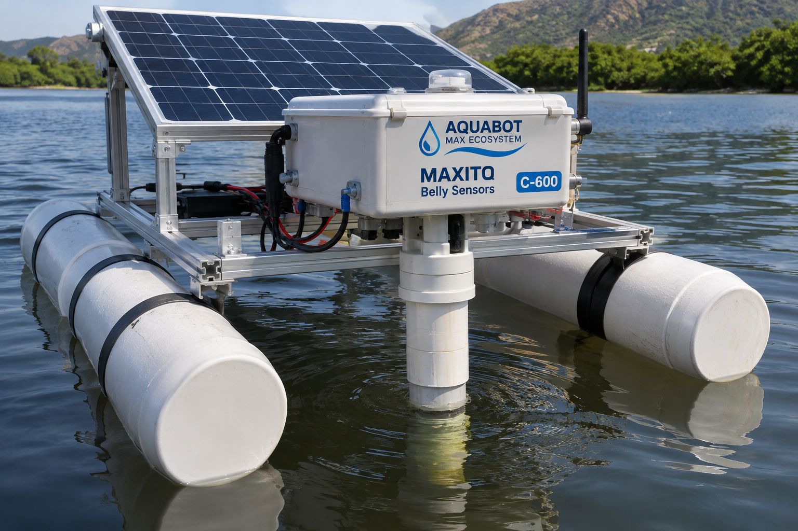
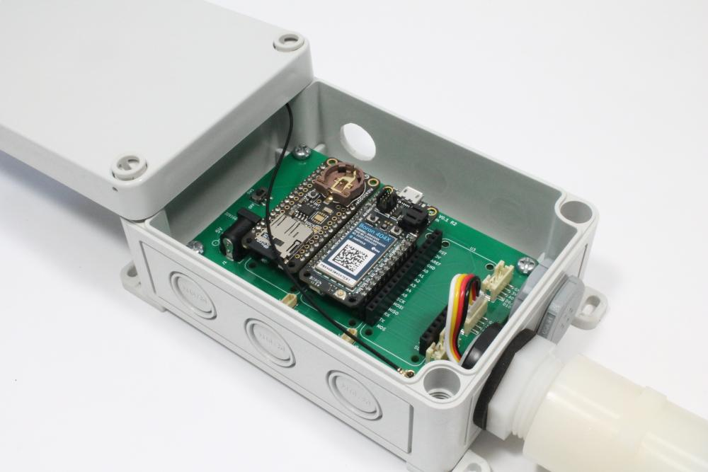

# MAXITO Belly Sensors

## C-600 Sensor Head | Cabezal de sensores C-600

**Project | Proyecto:** AQUABOT MAX ECOSYSTEM  
**Organization | Organización:** ODEVE — Open Development Ecosystem  
**Model | Modelo:** MAXITO Belly Sensors  
**Sensor head | Cabezal de sensores:** C-600  
**Category | Categoría:** Aquatic monitoring technology | Tecnología de monitoreo acuático

---

## 1. Overview | Descripción general

### English

MAXITO Belly Sensors is a model within the AQUABOT MAX ECOSYSTEM technological development initiative.

This section documents the MAXITO device and its C-600 sensor head, including physical design, technological evolution, field photographs, and available technical evidence.

### Español

MAXITO Belly Sensors es un modelo desarrollado dentro de la iniciativa tecnológica AQUABOT MAX ECOSYSTEM.

Esta sección documenta el dispositivo MAXITO y su cabezal de sensores C-600, incluyendo diseño físico, evolución tecnológica, fotografías de campo y evidencia técnica disponible.

---

## 2. Technological Evolution | Evolución tecnológica

| Development aspect | English description | Descripción en español |
|---|---|---|
| Model identity | MAXITO Belly Sensors | MAXITO Belly Sensors |
| Sensor head | C-600 sensor head | Cabezal de sensores C-600 |
| Project integration | Part of AQUABOT MAX ECOSYSTEM | Parte de AQUABOT MAX ECOSYSTEM |
| Documentation | Technical and photographic documentation of the model | Documentación técnica y fotográfica del modelo |
| Validation | Technical specifications and performance evidence to be incorporated after verification | Especificaciones técnicas y evidencia de desempeño pendientes de incorporar tras su verificación |

---

## 3. Photographic Evidence | Evidencia fotográfica

### MAXITO Belly Sensors C-600 | Technological Development

MAXITO Belly Sensors C-600 represents a new stage in the evolution of AQUABOT MAX ECOSYSTEM, integrating advances in aquatic monitoring, electronic control, solar energy, and floating platform design.

Its C-600 sensor head is attached to the lower section of the main enclosure and incorporates a seven-sensor monitoring system designed to support physicochemical water-quality measurements.

The project continues advancing through electronic integration, technical adjustments, and field validation.

### MAXITO Belly Sensors C-600 | Desarrollo tecnológico

MAXITO Belly Sensors C-600 representa una nueva etapa en la evolución de AQUABOT MAX ECOSYSTEM, integrando avances en monitoreo acuático, control electrónico, energía solar y diseño de plataformas flotantes.

Su cabezal C-600 está acoplado a la parte inferior del contenedor principal e incorpora un sistema de siete sensores diseñado para apoyar las mediciones fisicoquímicas de la calidad del agua.

El proyecto continúa avanzando mediante integración electrónica, ajustes técnicos y validación en campo.

### Design Gallery | Galería de diseño

| Photograph / Fotografía | Description | Descripción |
|---|---|---|
|  | Conceptual design of the MAXITO Belly Sensors C-600 floating monitoring platform, integrating solar energy, PVC flotation structures, and the sensor head beneath the main enclosure. | Diseño conceptual de la plataforma flotante de monitoreo MAXITO Belly Sensors C-600, que integra energía solar, flotadores de PVC y el cabezal de sensores debajo del contenedor principal. |
|  | Conceptual illustration of the electronic control system supporting the development and integration of MAXITO Belly Sensors C-600. | Ilustración conceptual del sistema de control electrónico que forma parte del desarrollo e integración de MAXITO Belly Sensors C-600. |

## 4. Technical Documentation | Documentación técnica

The following information will be documented as verified evidence becomes available:

- Physical structure and dimensions.
- C-600 sensor head configuration.
- Integrated sensors and measured parameters.
- Electronic and communications architecture.
- Power supply and autonomy.
- Field installation and operation.
- Maintenance and validation procedures.

Se documentará la siguiente información conforme se disponga de evidencia verificada:

- Estructura física y dimensiones.
- Configuración del cabezal C-600.
- Sensores integrados y parámetros medidos.
- Arquitectura electrónica y de comunicaciones.
- Alimentación eléctrica y autonomía.
- Instalación y operación en campo.
- Procedimientos de mantenimiento y validación.

---

## 5. Relationship to AQUABOT MAX ECOSYSTEM | Relación con AQUABOT MAX ECOSYSTEM

MAXITO Belly Sensors is documented as a distinct model within the AQUABOT MAX ECOSYSTEM technology family. Its configuration and capabilities will be distinguished from earlier prototypes and floating monitoring stations.

MAXITO Belly Sensors se documenta como un modelo diferenciado dentro de la familia tecnológica AQUABOT MAX ECOSYSTEM. Su configuración y capacidades se distinguirán de los prototipos iniciales y las estaciones flotantes anteriores.

---

**AQUABOT MAX ECOSYSTEM**  
**ODEVE — Open Development Ecosystem**
