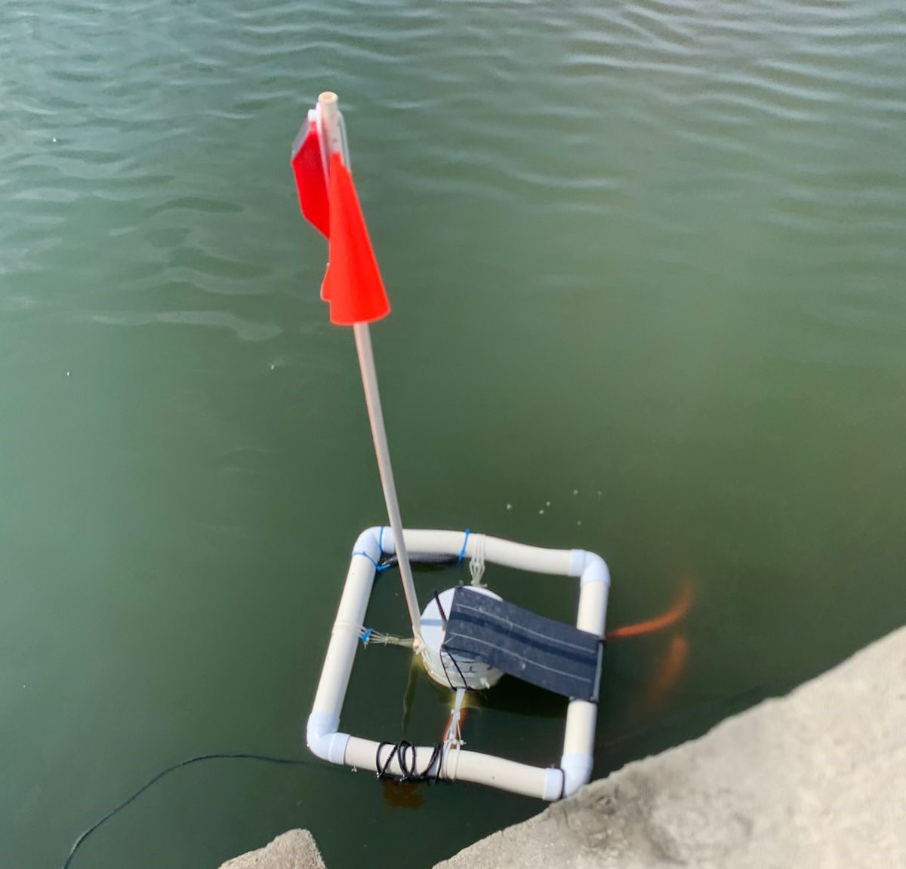
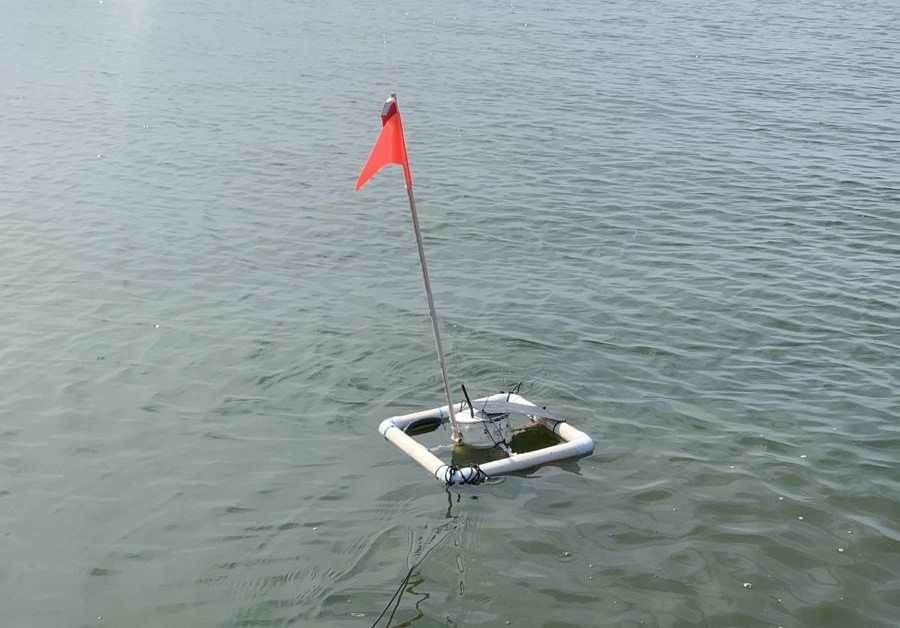
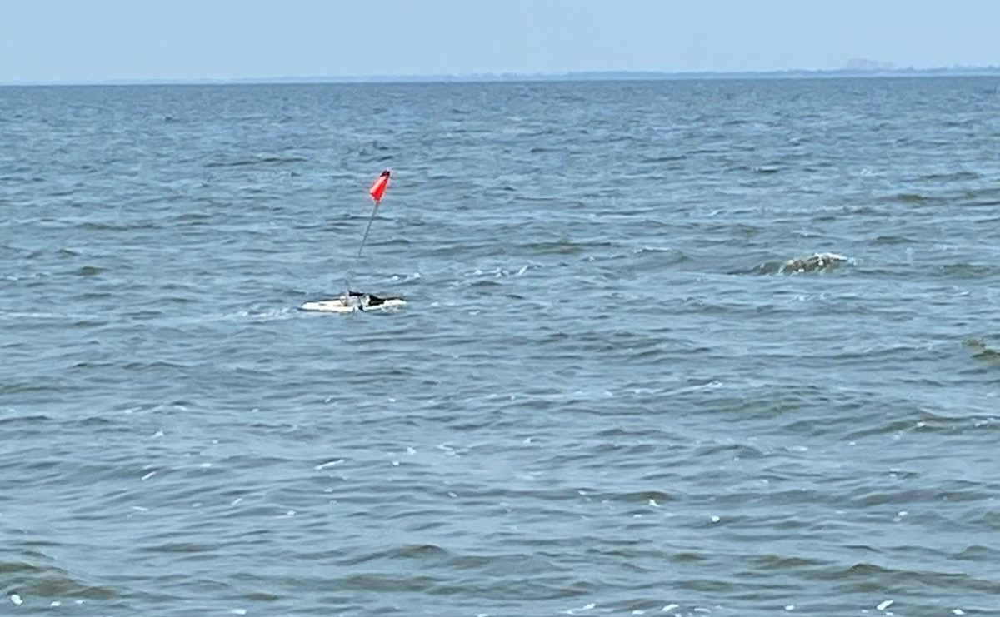

# AQUABOT MAX ECOSYSTEM

## Post-Otis Monitoring Stations | Estaciones de monitoreo posteriores a Otis

**Project:** AQUABOT MAX ECOSYSTEM  
**Organization:** ODEVE — Open Development Ecosystem  
**Development period:** After Hurricane Otis (October 2023)

---

## 1. Background | Antecedentes

### English

Following the loss of the initial AQUABOT prototypes during Hurricane Otis in October 2023, the project continued through the reconstruction and improvement of its environmental monitoring stations.

The subsequent development stage focused on the practical requirements of monitoring physicochemical water quality under coastal lagoon conditions.

The photographic record documents the evolution of the equipment, its physical installation, solar-powered components, sensor conduits, mounting arrangements, and field operation.

### Español

Después de la pérdida de los primeros prototipos AQUABOT durante el huracán Otis, en octubre de 2023, el proyecto continuó mediante la reconstrucción y el mejoramiento de sus estaciones de monitoreo ambiental.

La siguiente etapa de desarrollo se enfocó en las necesidades prácticas del monitoreo de la calidad fisicoquímica del agua en las condiciones propias de las lagunas costeras.

El registro fotográfico documenta la evolución de los equipos, su instalación física, los componentes de alimentación solar, conductos para sensores, mecanismos de sujeción y operación en campo.

---

## 2. Technological Development | Desarrollo tecnológico

| Component | Componente | Description |
|---|---|---|
| ESP32 microcontroller | Microcontrolador ESP32 | Electronic platform for sensor acquisition and IoT connectivity. |
| Solar energy system | Sistema de energía solar | Solar panel and battery-based power architecture. |
| Physicochemical monitoring | Monitoreo fisicoquímico | Water temperature, pH, TDS, electrical conductivity and additional monitored or calculated indicators. |
| Protective housing | Contenedor de protección | Enclosure designed to accommodate electronic components during field deployment. |
| Sensor conduits | Conductos para sensores | External conduits protecting sensor connections toward the water. |
| Mounting system | Sistema de sujeción | Mechanical elements for securing the station to field structures. |
| Remote monitoring | Monitoreo remoto | Transmission and visualization of environmental measurements through the AQUABOT ecosystem. |

---

## 3. Photographic Evidence | Evidencia fotográfica

This section will document authentic photographs of the monitoring stations developed after Hurricane Otis.

Esta sección documentará fotografías auténticas de las estaciones de monitoreo desarrolladas después del huracán Otis.

The photographs will be organized with independent English and Spanish descriptions.

Las fotografías se organizarán con descripciones independientes en inglés y español.

### Floating AQUABOT Stations | Estaciones flotantes AQUABOT

The following photographs document floating AQUABOT monitoring stations from the post-Otis development stage.

Las siguientes fotografías documentan estaciones flotantes AQUABOT correspondientes a la etapa de desarrollo posterior al huracán Otis.

| Photograph / Fotografía | Description | Descripción |
|---|---|---|
|  | Floating AQUABOT station with a rectangular PVC flotation frame, solar panel, electronic enclosure, and red identification flag, positioned beside a concrete shoreline. | Estación flotante AQUABOT con estructura rectangular de flotación de PVC, panel solar, contenedor electrónico y bandera roja de identificación, ubicada junto a una orilla de concreto. |
|  | Additional photographic view of the floating AQUABOT station, documenting its physical configuration and deployment in the water. | Vista fotográfica adicional de la estación flotante AQUABOT, que documenta su configuración física y despliegue en el agua. |
|  | Field photograph of a floating AQUABOT station, documenting its positioning within the monitored water body. | Fotografía de campo de una estación flotante AQUABOT, que documenta su ubicación dentro del cuerpo de agua monitoreado. |

---

## 4. Scientific and Environmental Relevance | Relevancia científica y ambiental

### English

The reconstruction of AQUABOT monitoring stations contributed to the continuity of field-based environmental observation.

The integration of local physicochemical measurements with satellite-derived information supports environmental analysis and research-oriented decision-making.

### Español

La reconstrucción de las estaciones AQUABOT contribuyó a la continuidad de la observación ambiental en campo.

La integración de mediciones fisicoquímicas locales con información derivada de satélites permite fortalecer el análisis ambiental y apoyar la toma de decisiones basada en investigación científica.

---

**AQUABOT MAX ECOSYSTEM — From Space to Water**

© 2026 ODEVE — Open Development Ecosystem
