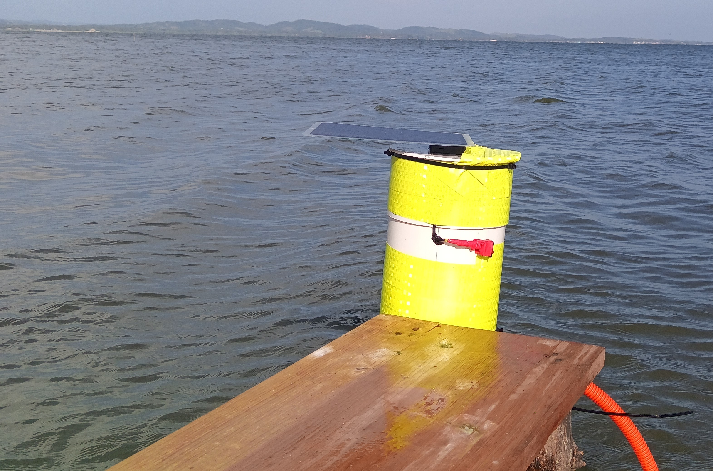
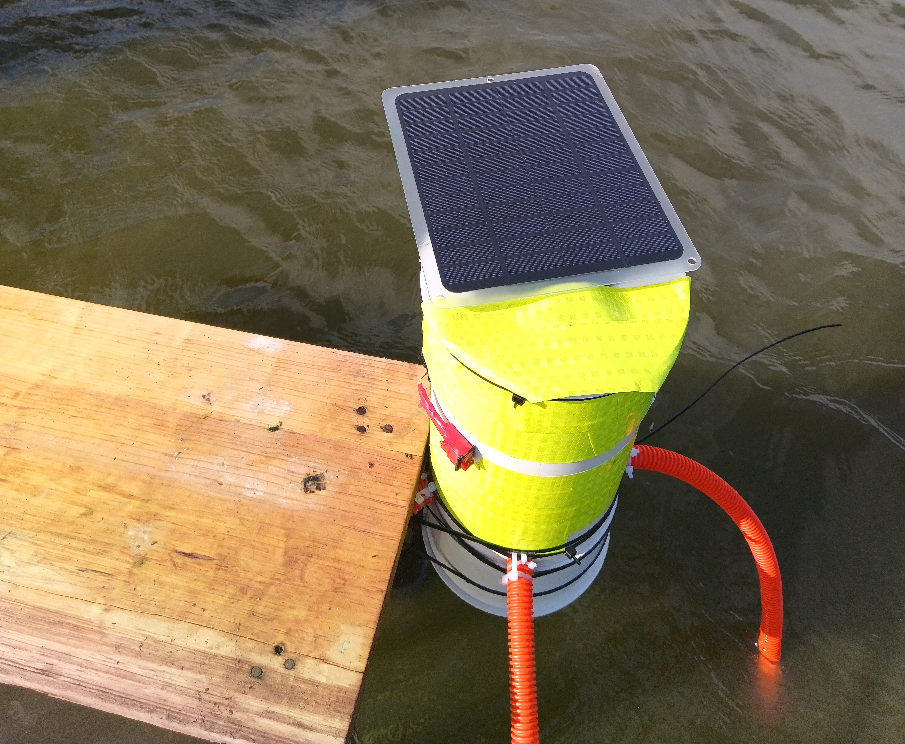
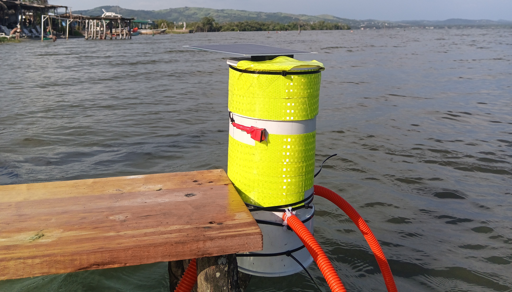
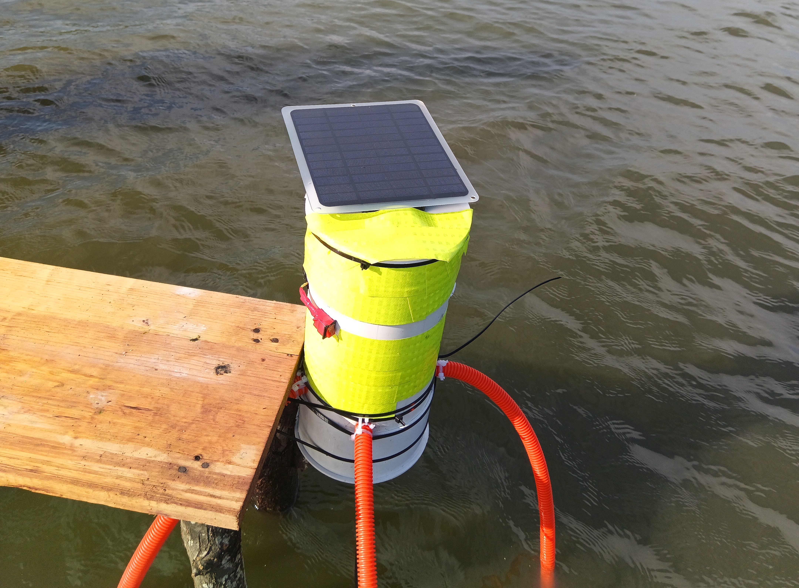
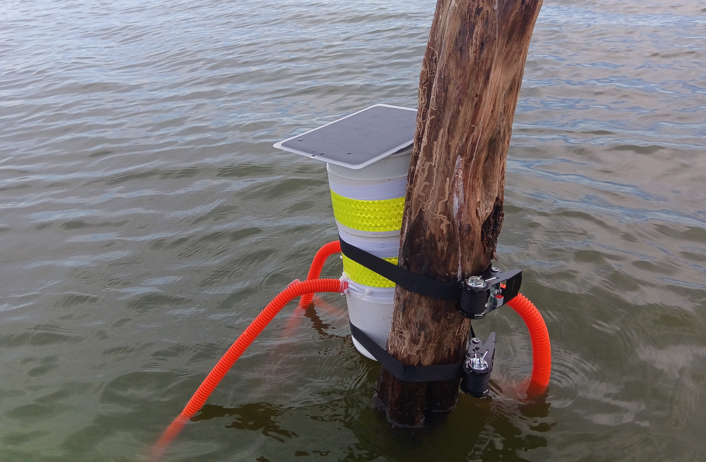

# AQUABOT MAX ECOSYSTEM
## Early Prototypes | Primeros prototipos

**Development stage:** Before Hurricane Otis (October 2023)

**Etapa de desarrollo:** Antes del huracán Otis (octubre de 2023)

---

### English

This directory documents the early experimental AQUABOT prototypes developed and deployed before Hurricane Otis struck Guerrero, Mexico, in October 2023.

The initial prototypes incorporated floating structures, solar-powered components, and experimental electronic systems intended to support water quality monitoring.

According to the project's historical record, these early units were lost during Hurricane Otis.

These photographs preserve evidence of the project's initial technological development and provide historical context for the subsequent evolution of AQUABOT MAX ECOSYSTEM.

### Español

Este directorio documenta los primeros prototipos experimentales AQUABOT desarrollados y desplegados antes del impacto del huracán Otis en Guerrero, México, en octubre de 2023.

Los prototipos iniciales incorporaban estructuras flotantes, componentes alimentados mediante energía solar y sistemas electrónicos experimentales destinados al monitoreo de la calidad del agua.

De acuerdo con los antecedentes del proyecto, estas primeras unidades se perdieron durante el huracán Otis.

Las fotografías conservan evidencia del desarrollo tecnológico inicial y proporcionan contexto histórico sobre la evolución posterior de AQUABOT MAX ECOSYSTEM.

---

**Project:** AQUABOT MAX ECOSYSTEM  
**Organization:** ODEVE — Open Development Ecosystem

## Historical Photo Gallery | Galería fotográfica histórica

### First-generation AQUABOT prototypes | Primeros prototipos AQUABOT

The following photographs document the early AQUABOT prototypes deployed before Hurricane Otis in October 2023.

Las siguientes fotografías documentan los primeros prototipos AQUABOT instalados antes del huracán Otis de octubre de 2023.

| Photograph / Fotografía | Description | Descripción |
|---|---|---|
|  | **Initial deployment.** Early AQUABOT prototype installed beside a wooden pier. | **Instalación inicial.** Primer prototipo AQUABOT instalado junto a un muelle de madera. |
|  | **Front view.** Solar panel, protective housing and sensor conduits. | **Vista frontal.** Panel solar, contenedor de protección y conductos para sensores. |
|  | **Upper view.** Arrangement of the solar power system and exterior components. | **Vista superior.** Distribución del sistema de energía solar y componentes exteriores. |
|  | **Field installation.** Monitoring prototype positioned along the lagoon shoreline. | **Instalación en campo.** Prototipo de monitoreo ubicado junto a la orilla de la laguna. |
|  | **Mounting system.** Rear view of the protective housing and external connections. | **Sistema de sujeción.** Vista posterior del contenedor de protección y conexiones exteriores. |

### Historical Significance | Importancia histórica

**English:** These prototypes represent an early stage in the development of AQUABOT. According to the project team's account, the units were lost during Hurricane Otis in October 2023. Their photographic documentation preserves evidence of the initial engineering approach.

**Español:** Estos prototipos representan una etapa inicial del desarrollo de AQUABOT. De acuerdo con los antecedentes proporcionados por el equipo, las unidades se perdieron durante el huracán Otis en octubre de 2023. Su documentación fotográfica conserva evidencia del planteamiento inicial de ingeniería.
