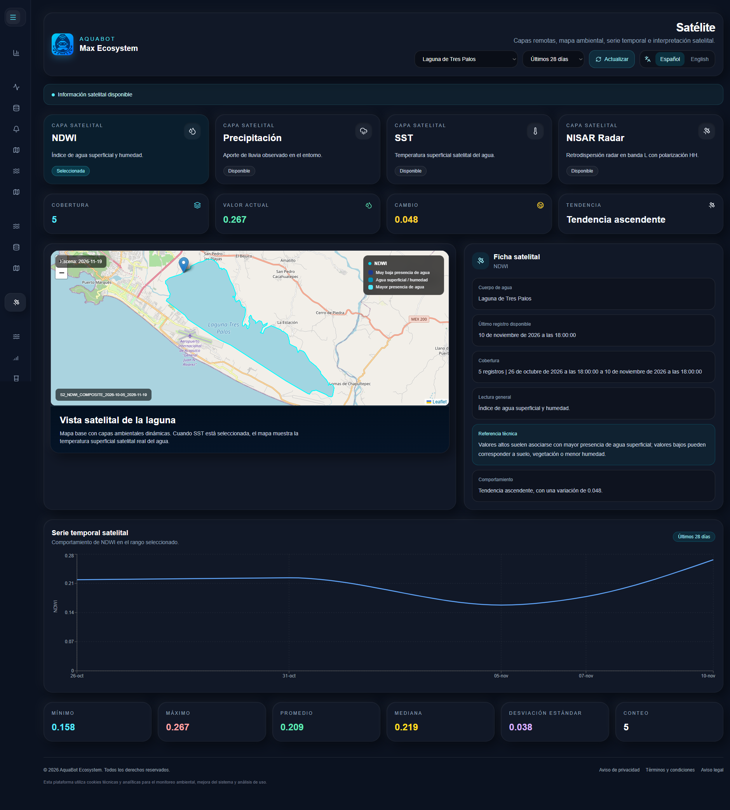
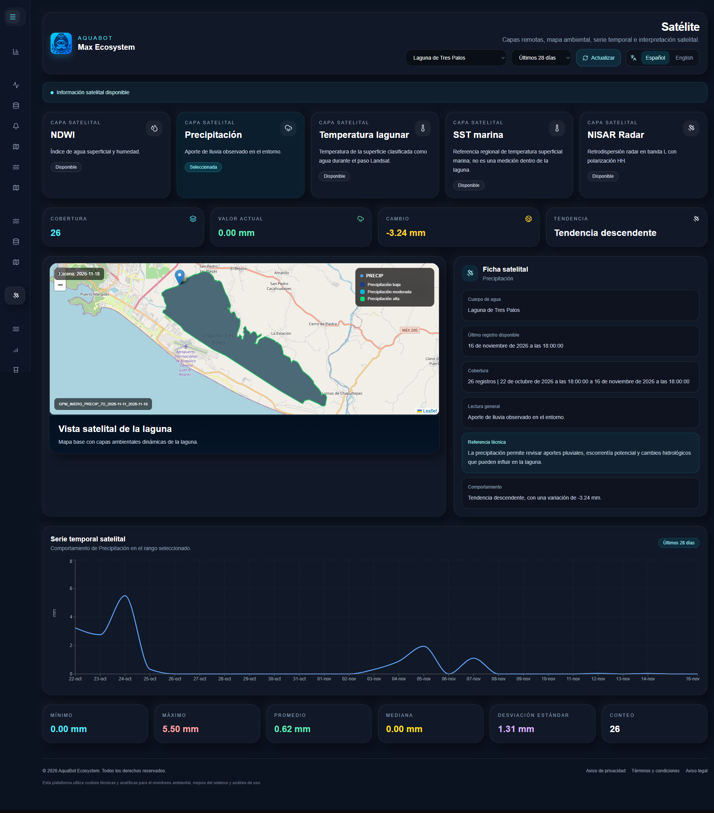
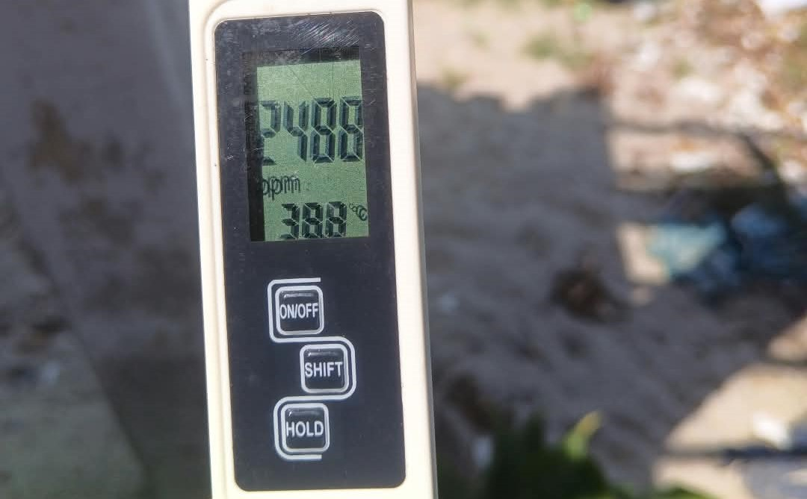

# AQUABOT MAX ECOSYSTEM

## Water Quality Monitoring | Monitoreo de la calidad del agua

**Project | Proyecto:** AQUABOT MAX ECOSYSTEM  
**Organization | Organización:** ODEVE — Open Development Ecosystem  
**Category | Categoría:** Environmental Monitoring and Remote Sensing | Monitoreo ambiental y percepción remota

---

## 1. Overview | Descripción general

### English

AQUABOT MAX ECOSYSTEM integrates field-based physicochemical water-quality measurements with satellite-derived environmental information to support aquatic ecosystem monitoring and socio-environmental decision-making.

The monitoring approach combines sensor observations, historical records, environmental indicators, and geospatial information.

### Español

AQUABOT MAX ECOSYSTEM integra mediciones fisicoquímicas de la calidad del agua realizadas en campo con información ambiental obtenida mediante satélites, para apoyar el monitoreo de ecosistemas acuáticos y la toma de decisiones socioambientales.

El enfoque de monitoreo combina observaciones de sensores, registros históricos, indicadores ambientales e información geoespacial.

---

## 2. Physicochemical Parameters | Parámetros fisicoquímicos

| Parameter | English description | Descripción en español |
|---|---|---|
| Temperature | Water temperature monitoring | Monitoreo de la temperatura del agua |
| pH | Measurement of water acidity or alkalinity | Medición de acidez o alcalinidad del agua |
| TDS | Total dissolved solids | Sólidos disueltos totales |
| Electrical conductivity | Measurement of water electrical conductivity | Medición de conductividad eléctrica del agua |
| Salinity | Estimation of dissolved salt concentration | Estimación de la concentración de sales disueltas |
| ORP / Redox | Oxidation-reduction potential | Potencial de oxidación-reducción |
| Dissolved oxygen | Measurement or estimation of dissolved oxygen, depending on sensor configuration | Medición o estimación del oxígeno disuelto, según la configuración de sensores |
| CO2 | Carbon dioxide monitoring or estimation, depending on system configuration | Monitoreo o estimación de dióxido de carbono, según la configuración del sistema |

---

## 3. Field Measurements | Mediciones en campo

### English

Field monitoring activities include equipment installation, periodic measurements, sensor inspection, maintenance, and verification of environmental conditions.

Measurement records help characterize changes in water-quality parameters over time and provide a basis for comparison with complementary environmental datasets.

### Español

Las actividades de monitoreo en campo incluyen la instalación de equipos, mediciones periódicas, inspección de sensores, mantenimiento y verificación de condiciones ambientales.

Los registros permiten caracterizar los cambios temporales de los parámetros de calidad del agua y proporcionan una base para su comparación con conjuntos de datos ambientales complementarios.

---

## 4. Satellite Monitoring Integration | Integración del monitoreo satelital

| Satellite indicator | English description | Descripción en español |
|---|---|---|
| NDWI | Normalized Difference Water Index for analyzing surface-water conditions | Índice Normalizado de Diferencia de Agua para analizar condiciones de agua superficial |
| LST | Land Surface Temperature as a complementary thermal indicator | Temperatura de la superficie terrestre como indicador térmico complementario |
| Precipitation | Satellite-derived rainfall estimates | Estimaciones de precipitación obtenidas por satélite |
| NDVI | Vegetation index for evaluating surrounding vegetation conditions | Índice de vegetación para evaluar las condiciones de la cobertura vegetal |
| SST | Sea Surface Temperature for applicable coastal environmental analyses | Temperatura superficial del mar para análisis ambientales costeros aplicables |
| Chlorophyll-a | Satellite-derived indicator associated with aquatic phytoplankton | Indicador satelital asociado con el fitoplancton acuático |
| KD490 | Optical indicator related to light attenuation in water | Indicador óptico relacionado con la atenuación de la luz en el agua |
| NISAR | Radar observations for complementary aquatic and environmental analysis | Observaciones de radar para análisis complementarios de ambientes acuáticos y su entorno |

---

### Satellite Monitoring Gallery | Galería de monitoreo satelital

#### NDWI — Surface Water Monitoring | Monitoreo de agua superficial

| Photograph / Fotografía | Description | Descripción |
|---|---|---|
|  | AQUABOT MAX ECOSYSTEM satellite monitoring dashboard showing the Normalized Difference Water Index (NDWI) for Tres Palos Lagoon, including geographic visualization, historical observations, temporal trends, and environmental statistics. | Panel de monitoreo satelital de AQUABOT MAX ECOSYSTEM que muestra el Índice Normalizado de Diferencia de Agua (NDWI) de la laguna de Tres Palos, incluyendo visualización geográfica, observaciones históricas, tendencias temporales y estadísticas ambientales. |

---

#### Precipitation — GPM IMERG | Precipitación — GPM IMERG

| Photograph / Fotografía | Description | Descripción |
|---|---|---|
|  | AQUABOT MAX ECOSYSTEM dashboard displaying satellite-derived precipitation estimates from GPM IMERG for the Tres Palos Lagoon area. The visualization includes a geographic map, a temporal rainfall series, and precipitation statistics expressed in millimeters. | Panel de AQUABOT MAX ECOSYSTEM que presenta estimaciones satelitales de precipitación mediante GPM IMERG para el entorno de la laguna de Tres Palos. La visualización incluye un mapa geográfico, una serie temporal de lluvia y estadísticas de precipitación expresadas en milímetros. |

---

## 5. Photographic and Measurement Evidence | Evidencia fotográfica y de mediciones

### English

This section will contain selected field photographs, measurement records, and visual documentation of the monitoring process.

Evidence will be organized according to the activity, equipment, and environmental information represented.

### Español

Esta sección contendrá fotografías seleccionadas de campo, registros de mediciones y documentación visual del proceso de monitoreo.

La evidencia se organizará de acuerdo con la actividad, el equipo y la información ambiental representada.

### Field Monitoring Gallery | Galería de monitoreo en campo

| Photograph / Fotografía | Description | Descripción |
|---|---|---|
|  | Field photograph of a portable water-quality meter displaying approximately 2,480 ppm of total dissolved solids (TDS) and 38.8 °C. The image documents an instrument reading obtained during field monitoring activities. | Fotografía de campo de un medidor portátil de calidad del agua que muestra aproximadamente 2,480 ppm de sólidos disueltos totales (TDS) y 38.8 °C. La imagen documenta una lectura del instrumento obtenida durante actividades de monitoreo en campo. |

---

## 6. Environmental Analysis | Análisis ambiental

### English

The integration of field measurements and satellite-derived indicators supports temporal analysis, contextual interpretation of environmental conditions, and the development of information tools for research and decision-making.

Satellite observations complement, rather than replace, direct water-quality measurements.

### Español

La integración de mediciones de campo e indicadores satelitales permite realizar análisis temporales, interpretar las condiciones ambientales en su contexto y desarrollar herramientas de información para la investigación y la toma de decisiones.

Las observaciones satelitales complementan, pero no sustituyen, las mediciones directas de calidad del agua.

---

**AQUABOT MAX ECOSYSTEM**  
**ODEVE — Open Development Ecosystem**
